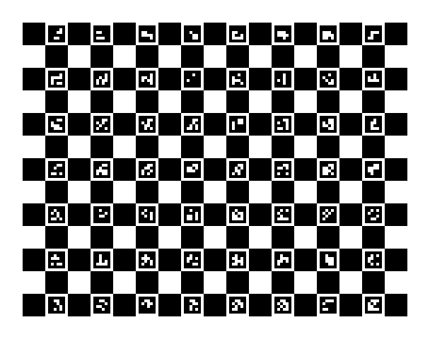

# Photo Wall

Photo Wall is a self-hosted system for a room of physically framed displays. Everyday output should feel like a collection of photographs: mostly still images, restrained video, and occasional coordinated effects. A holiday slideshow can evolve throughout December; two portraits can briefly talk to each other; an overlay can reveal the current background when it finishes.

Immich remains the media library. Photo Wall manages physical locations, display calibration, presentation policy, schedules, and compatible media assignments. A **Frame** identifies a location; a replaceable **Player** supplies its output. Scenes can combine explicitly chosen Frame locations and lights while leaving unrelated targets alone. Players prepare upcoming assignments in a bounded rolling window and render locally.

Players [appear centrally without local setup](docs/requirements.md#player-provisioning) — a diskless Pi netboots a generic base image with Central named on its kernel command line, fetches the Player app from central, and enrolls itself by its own hardware serial on a trusted LAN. They receive assets exclusively from the central show system and [remain unaware of Immich](docs/requirements.md#central-media-boundary).

## Project status

**MVP implementation in progress.** Central and the media worker launch with PostgreSQL, and the full real-media demo passes with two network Players and three simulated Outputs, including live Immich updates and outage/rejoin recovery.

Provisioning has one path, the node path ([decision 0014](docs/decisions/0014-reaching-central-from-every-boot-stage.md) for reaching Central, [decision 0019](docs/decisions/0019-debian-packaging-with-debhelper.md) for the packages): a diskless Pi netboots a **generic boot tree** whose kernel command line names Central (e.g., `photowall.central=http://photo-wall.localdomain/`); its first stage locates Central, takes a node boot offer and mounts the offered base read-only in RAM; the base's node units then run the Player app from a sealed release root that Central serves as a squashfs image; the Player enrolls itself by hardware serial into an operator pending queue over HTTP or HTTPS. No flashing, no per-device secret, and no signing: a home LAN has no threat model to defend, so the only integrity checks are content hashes against corruption. Shipping an update is selecting a newer release on the console's **Releases** page, not a re-image. Physical Pi 5 boot, real HDMI output and timing have no automated tier and need bench evidence. See [Status and caveats](#status-and-caveats), the [setup and recovery runbook](docs/runbook.md), the [delivery checklist](docs/implementation-checklist.md), and [acceptance evidence](docs/evidence/README.md).

The foundation is one modular central application and a media preparation worker, with one Python Player process on each Raspberry Pi that finishes each Frame's picture once on the GPU and hands it to the display controller as its own display plane ([0029](docs/decisions/0029-render-planes.md)). Weston hosts the display session. Rendering capacity, real network boot, and visible synchronization still require hardware qualification.

## Getting started

Photo Wall has two halves, and you can meet the first one in about five minutes:

1. **The central control plane** — a Docker Compose stack (central service, PostgreSQL, media worker) that you host: the operator interface, the scheduler, and the media pipeline. **You can run this today on any machine with Docker.**
2. **The Player appliances** — diskless Raspberry Pi 5 devices that render to framed displays. **No flashing, no per-device install, no per-device secret.** Every Pi netboots one generic boot tree with Central named on its kernel command line, mounts the base and Player app images Central serves, and enrolls itself by its own hardware serial over the LAN. **This half needs a trusted LAN, a boot server, and physical hardware.**

New here? Start with the control plane below. Come back for [Bring a display online](#bring-a-display-online) when you have Pi hardware on the same LAN.

> **Project maturity:** an MVP in active development. The control plane and its full media demo work today. The node path (netboot → node boot offer → release root → self-enroll → bind → render) is exercised in CI by the real-systemd node scenarios and the Node package tests; **real network boot, real HDMI output and timing on physical Pi 5 hardware have no automated tier.** See [Status and caveats](#status-and-caveats) before you depend on the Player half.

### Bring a display online

Once central is running, bringing a display online is four steps, and **none of them touch the individual Pi**:

1. **Let Central choose the release, or choose it yourself.** Central's worker watches your project's published GitHub releases, records each valid node release as a deployment and downloads the newest ones in the background. On a wall that never had a boot selection it selects the newest stable release by itself; after that, you pick a release on the console's **Releases** page ([Releases, Stage app and Update the wall](docs/runbook.md#releases-stage-app-and-update-the-wall)). Every Pi is offered the selection at its next boot; shipping an update is selecting a newer release, never re-imaging.
2. **Stage the boot tree on your boot server.** Kernel, initrd, device tree and `cmdline.txt` from one published release, the same bytes for every Pi, carrying no application ([runbook](docs/runbook.md#player-provisioning-stage-the-netboot-bundle-and-read-its-console-0014), [PXE service setup](docs/module-pxe-service.md)).
3. **Netboot a Pi 5** on the LAN. Its first stage finds Central from the kernel command line, takes a node boot offer, mounts the base and the Player app images, and the Player **enrolls by hardware serial, appearing unbound in the operator UI.** No boot ticket, no signature, no pre-registration, no baked-in secret (see [decision 0014](docs/decisions/0014-reaching-central-from-every-boot-stage.md)).
4. **Draw a Frame, bind the detected Output, and calibrate the Frame.** To put media on it, make a Scene that targets that Frame, then Show now or schedule the Scene as a Program. A reboot re-associates by serial automatically, and **unbind** frees a Frame later without retiring the hardware.

That is the whole model: **one published release** (the boot tree, the base and the app images, from GitHub), one boot server, zero per-device setup. The hashes Central and the Pi check are **corruption checks only**; nothing here is signed. The detailed map (what you provide, the assets, and how a Player comes online) is in [Provision Player appliances](#provision-player-appliances).

**The paper calibration target** ([print it](docs/runbook.md#calibration-targets)): [Letter](central/displays/calibration_sheets/photo-wall-calibration-target-letter.pdf) · [A4](central/displays/calibration_sheets/photo-wall-calibration-target-a4.pdf) · [4 × 6 in photo print](central/displays/calibration_sheets/photo-wall-calibration-target-4x6.pdf). Print it on any printer and ink, lay it on a Frame's screen while the screen shows its own target, and one phone photo of both tells how far the display's picture is from the paper.



### Run the control plane locally

**You need:** Git, Docker Engine or Desktop with Compose, and Python 3.12 (for the config script and development tests). No paid runtime service is required.

```sh
git clone https://github.com/mcurcio/photo-wall.git
cd photo-wall
python3 scripts/configure.py
docker compose up -d --build --wait
curl --fail http://127.0.0.1:8000/healthz
```

What each step does:

1. **`scripts/configure.py`** writes a private `.env` (mode `0600`) holding a generated database password and operator token. It never overwrites an existing `.env`, so it is safe to re-run.
2. **`docker compose up`** builds and starts the central service, PostgreSQL, and the Procrastinate media worker. The web listener and database bind to loopback only.
3. **`curl .../healthz`** should return success. A green `/healthz` means the database is reachable and the scheduler ticked recently — it reports liveness, not that anything is on screen. While starting up it returns `503`; give it a few seconds.

Then open **`http://127.0.0.1:8000`**, read the `PHOTO_WALL_ADMIN_TOKEN` value from `.env`, and paste it to sign in. You sign in once per browser: the sign-in lasts 30 days, **Log out** in the header ends it, and changing the token signs every browser out (see [signing in and Log out](docs/runbook.md#operator-console-signing-in-and-log-out)).

From the operator interface you can list Players and Outputs, create persistent Frames, bind equipment to them, calibrate (preview / commit / revert), create and edit Sources and Scenes, schedule Programs, and drive Runs. Program times are shown in your browser's local time zone.

The redesigned console now serves at **`/`** (with **`/console`** kept as an alias); the old flat page has been retired. It always opens on the **Wall**. Each Surface gets a 2D **wall plan** that draws each Frame from where it hangs (`x_mm/y_mm`, its top-left) at its real size, worked out from its Position box and its display's own size ([0030](docs/decisions/0030-frame-box.md); a dashed outline while that size is not known), so you read the physical layout instead of a table; legacy Frames created at the origin with no distinct geometry collect in an **Unplaced tray** beside the plan. One click on a Frame opens **its page**, with four tabs — **Overview** (the default: what Central puts on it and why), **Position** (where the picture sits on the Display), **Picture** (brightness) and **Hardware** (the Pi and HDMI output serving it, the display and its size, and the Frame's **Shows videos** and worked-out size). The tile and Overview are deliberately honest: they carry one `planned` fact, for example **_On top: xmas · Program dec-evenings (Central's Runs; media not checked; the Panel is not observed)_**, because it reports what central *intends* to show and who started it — it never claims confirmed playback and never labels a Frame "LIVE." Each tile also carries one health state (for example *Player silent*, *Output interrupted*, *Needs calibration*, *Heard recently*) derived from when Central last heard a report from the Player, and an **attention strip** in the header counts the Frames that need you (see [wall health and the attention strip](docs/runbook.md#operator-console-wall-health-and-the-attention-strip)). **Position** sets the visible picture as a box on the screen: drag it or any edge or corner, nudge in 1, 10 or 50 pixel steps, or type its left, top, width and height; its width and height are independent, and the box is the Frame's shape; **Picture** sets the brightness Photo Wall gives the picture it sends. Each change shows on the Display while the tab is open (no time limit), **Done** keeps it once the Pi has shown it, and **Revert** undoes it (see the [runbook](docs/runbook.md#operator-console-calibration-and-conflict-states)). New or replacement Players appear on the **Players** list (`#/players`, one row per box: not enrolled / unbound / bound / retired), and each box has one **Player page** showing its node layers (including Display Host's current per-Output reports), Outputs, boot records, reboot, app operations with **Stage app** and **Qualified fallback**, with the serial labelled as a claim ([the Players pages](docs/runbook.md#the-players-list-and-the-player-page)); **Releases** (`#/releases`) publishes a release and sets the fleet-wide boot selection, and **Update the wall** walks a release onto the wall one Player at a time ([Releases, Stage app and Update the wall](docs/runbook.md#releases-stage-app-and-update-the-wall)); you bind one by choosing a Player and Output on the Frame's **Hardware** tab, or a free Output from its Player page (a bind forces a "Review required" recalibration but never discards committed calibration), and a returning known Pi reappears already bound by serial match, not identity, with its enrollment shown on its Player page (see [onboarding, binding, and auto-recovery](docs/runbook.md#operator-console-onboarding-binding-and-auto-recovery)). You now **edit the wall plan by direct manipulation**: click or drag on the plan to **place** a new Frame's top-left (then name it and choose whether it shows videos), drag an existing Frame to **move** it (last-write-wins, never a resize), drag a Frame out of the **Unplaced tray** to give it a position, or **delete** a Frame that is neither bound nor targeted by a live Run (see [placing, moving, and deleting Frames](docs/runbook.md#operator-console-placing-moving-and-deleting-frames-and-the-unplaced-tray)). A **sidebar of sections** (organization, not permission — the same single admin token) replaces the old Wall / Showrunner toggle, in a look matched to the photo library's colours and type; every section and every step has its own `#/…` address, so links and bookmarks work ([sections, links and drafts](docs/runbook.md#operator-console-sections-links-and-drafts)). The Wall side is **Wall**; the fleet side is **Players** and **Releases**; **Needs attention** is a section of its own, on neither side, listing what needs you with links into the Wall. **Settings** holds the **Photo library** (the Immich connections). The Show side is **Now**, **Scenes**, **Schedule** and **Sources**, where you add and edit a **Photo source** in one editor (a saved question to Immich with a plain name: albums, people, a place, dates, favourites, tags and media types, minus albums, people, tags and screenshots you leave out; its pool fills beside the form as Immich is read, before you save; internal revisions stay hidden), and each other job is a short **step flow** with one question per step, defaults filled and a **Review** that lists every answer: make a **Scene** (live from a Source or hand-picked per frame; the console derives each id; "Keep playing until the Program ends" is on by default; Edit opens at Review and offers Reload when someone else saved meanwhile; see [viewing and editing a Scene](docs/runbook.md#viewing-and-editing-a-scene)), **schedule** it as a Program (one window, or separate windows at the same local times; each card reads Upcoming, Running, Ran, Refused or Missed), and **show it now** (the priority defaults to the Run already on top, and a retry after an unknown outcome cannot start it twice). Now has **Run cards** (finish or cancel), a **Why?** per frame that states Central's Runs with each layer's priority and its limits, a [Why nothing new?](docs/runbook.md#why-nothing-new-on-a-frame) walk, and the **Media pipeline** panel ([the media pipeline](docs/runbook.md#the-media-pipeline)). Unsaved drafts survive section changes, refreshes and a session that expires under the sign-in screen; Log out or a reload discards them. Every control that cannot act says why. The Show sections deliberately cannot reach a Frame's Position or Picture — at show time the only hardware fact they surface is each Frame's health state (see [running the show](docs/runbook.md#operator-console-running-the-show)).

To stop:

```sh
docker compose down        # add -v to also delete the database, cache and hub-config volumes
```

### Connect a real media library (Immich)

Photo Wall keeps using Immich as the media library; only the media worker talks to it, and Players never do. Open **Settings › Photo library** (`#/photo-library`), press **Add a connection**, and paste a name, the Immich address (for example `http://immich.local:2283`) and an API key made in Immich with [these permissions](docs/runbook.md#the-library-key). Save checks it at once: within about a minute the row shows Immich's counts and the Immich user the key belongs to. No file and no restart. The key is kept in Central's database and never shown again ("Key ending …1234"); a database backup therefore holds it ([decision 0020](docs/decisions/0020-immich-key-in-central-database.md)). If a check fails, the row reads **Needs a look** with one fix, and photos keep playing meanwhile.

Then make a **Photo source** on **Sources**: a saved question to Immich (albums, people, a place, dates, favourites, tags, minus what you leave out). Its photos appear beside the form as Immich is read, before you save. The full procedure, including upgrading from the old connections file, is in the [runbook](docs/runbook.md#connecting-immich); what a check reads is in the [media module](docs/module-media.md).

### Development checks

```sh
uv sync --frozen
.venv/bin/python -m pytest -q
.venv/bin/python -m ruff check .
python3 scripts/check_docs.py
```

With the disposable test database running (`docker compose -f tests/integration/compose.test-database.yml up -d --wait`; see the [runbook](docs/runbook.md#tests-and-local-development)), also run `.venv/bin/python scripts/test_local.py -q -n auto`. Report any skipped integration checks explicitly rather than treating a pass as full coverage. See [CONTRIBUTING.md](CONTRIBUTING.md) for the engineering approach.

## Provision Player appliances

A Player is a diskless Raspberry Pi 5 that renders to one or two HDMI displays. Every Pi boots the **same** generic boot tree and is offered the **same** selected release by Central: the Pi is interchangeable hardware, and a **Frame** is the persistent location it serves. There is **no per-device install, no per-device secret, and no flashing**: the Pi's kernel command line names Central, it mounts the base and the Player app images Central serves, and enrolls itself over HTTP or HTTPS, showing up **unbound** for you to bind. See [decision 0014](docs/decisions/0014-reaching-central-from-every-boot-stage.md) for the model.

Most of this lives outside this repo — your LAN, your Pi hardware, and a DHCP/TFTP boot server. The pages linked below own the exact commands; this is the map.

### What you provide

- **Hardware:** Raspberry Pi 5 with 4 GB of memory or more, and active cooling; a smaller board is refused at boot ([supported hardware](docs/requirements.md#supported-player-hardware)). Videos play from one 1080p30 HEVC copy each, decoded by the Pi 5's hardware ([0029](docs/decisions/0029-render-planes.md)). ([platform notes](docs/module-appliance-platform.md))
- **A trusted LAN** central and the Pi both reach. The model trusts that LAN: Central is named on the netboot command line (see [decision 0014](docs/decisions/0014-reaching-central-from-every-boot-stage.md)); there is no mDNS discovery. Transport is HTTP or HTTPS, identity is the Pi's serial. **No signing keys anywhere**: the only integrity checks are content hashes against corruption.
- **Central reachable from that LAN.**
- **A DHCP/TFTP boot server** on that LAN to netboot the boot tree (kernel + initrd over TFTP; Central serves the base image over HTTP). [PXE service setup](docs/module-pxe-service.md) owns the tree layout and DHCP/tftpd configuration.

### The published release

Each GitHub release carries everything a Pi needs; build it yourself with the [Debian packaging module](docs/module-debian-packaging.md) if you prefer:

1. **The boot tree**: `config.txt`, a one-line `cmdline.txt` template (replace `@@PHOTOWALL_CENTRAL@@` with Central's root URL), the Pi 5 kernel, the initrd and the device tree, published as `photo-wall-boot-<revision>.tar.gz`. Stage it in your boot server's tree ([runbook](docs/runbook.md#player-provisioning-stage-the-netboot-bundle-and-read-its-console-0014)). It carries no application and almost never changes.
2. **The base and the release roots**: the base squashfs and the sealed Player app and App Manager root images. Central's worker downloads them from the release into its one cache root (`PHOTO_WALL_CACHE_ROOT`, [Central cache subsystem](docs/module-central-cache.md)) and serves them to each Pi through its node boot offer; you never stage them by hand.

### How a Player comes online

1. The Pi netboots the boot tree; stage 1 locates Central from the kernel command line, takes a node boot offer, fetches the offered base over HTTP (content-checked) and mounts it read-only in RAM: no local storage, no state left behind.
2. The base's node units start; the App Effect Broker launches the Player from the sealed app root image Central serves, mounted read-only ([Player architecture](docs/player-architecture.md)). Nothing installs a `.deb` on a Pi.
3. The Player reads the Pi's hardware serial and enrolls over HTTP. **Central shows it pending: no boot ticket, no pre-registration, no baked-in secret.**
4. You bind that Player to a Frame and calibrate it, in the same operator interface from the control-plane section. **Unbind** later (reversible) to free the Frame without retiring the hardware.
5. A reboot of a bound Pi re-associates with its Frame automatically, by serial, and is offered the current boot selection, so it also picks up any release you have selected.

### Status and caveats

Be honest with yourself about what is proven:

- **Working and tested (software, CI):** kernel command-line Central naming, locate-through-redirects, hardware-serial identity, ticketless enrollment over HTTP, named failure logging, the operator pending queue, and bind/unbind, against a real PostgreSQL-backed central; the node packages build and their tests pass (`node-components.yml`); the node lifecycle runs under real systemd in the PID1 scenarios (`node-pid1.yml`); the full media path runs in the software e2e.
- **No automated tier:** booting on **physical Raspberry Pi 5 hardware** over a real network boot, real display planes and HDMI output on real panels, and timing (the render bench on the test Pi, [runbook](docs/runbook.md#the-render-bench-and-pi-testing-before-merge)). CI proves the software contract, not real pixels or a real kernel boot; these need bench evidence ([which evidence](CONTRIBUTING.md#choose-the-right-evidence)).
- **Not yet qualified regardless:** on-device native rendering and cache reuse, dual-HDMI output, and visible multi-Player synchronization.

Track progress against the [delivery checklist](docs/implementation-checklist.md) and dated [acceptance evidence](docs/evidence/README.md). A passing CI run does not establish physical-Pi, real-Immich, or visible-timing behavior.

## Home Assistant: the Galleria integration

Galleria is the integration for Home Assistant (its future name for this project). It shows your wall in Home Assistant as devices: **Central**, the **Installation**, one **Player** per Pi (with an update you can install on that Pi alone) and one **Frame** per Frame (Showing, and the light on the Frame). It also publishes Home Assistant's lights and light sensors to Central, which the room-light setup listens to. It talks to Central's hub and to each Pi over NATS on your home network, with no broker and no token to make.

Install it with [HACS](https://hacs.xyz):

1. In HACS, open the menu › **Custom repositories**, add `https://github.com/mcurcio/photo-wall` with the type **Integration**, then download **Galleria** and restart Home Assistant. Every release carries `galleria.zip`, built automatically with the release and versioned from its tag; HACS installs that file and offers each new release as an update.
2. In **Settings › Devices & services**, press **Add integration** and pick **Galleria**.
3. Enter Central's address, as you open its console (for example `http://photo-wall.local` or `http://192.168.1.10:8000`). Galleria checks it by reading Central's version; one entry per Central.

Home Assistant needs to reach Central's address and each Pi's address on the home network (Central lists them; each Pi's read-only door is port 4280). The code lives in `custom_components/galleria/`; its tests run in their own environment (`galleria_tests/requirements.txt`).

## Documentation

Start with the [documentation guide](docs/README.md), or choose a topic:

| Document | Purpose |
|---|---|
| [Requirements](docs/requirements.md) | Product behavior, terminology, and scope. |
| [Architecture](docs/architecture.md) | Components, ownership, and platform choices. |
| [Execution contract](docs/execution-contract.md) | Planning, readiness, commitment, timing, and recovery. |
| [Implementation plan](docs/implementation-plan.md) | Bounded slices and their dependencies. |
| [Validation](docs/validation.md) | Scenarios, experiments, and performance evidence. |
| [Design decisions](docs/design-decisions.md) | Open choices and their decision criteria. |

## Contributing

See [CONTRIBUTING.md](CONTRIBUTING.md) for required engineering principles, recursive module design, agent orchestration, and evidence expectations. The first implementation tracks are central execution with simulated devices and a physical Player prototype driving two panels. They can progress independently and meet at a concrete execution contract. Focused contributions should advance a demonstrable scenario and document what was verified.
