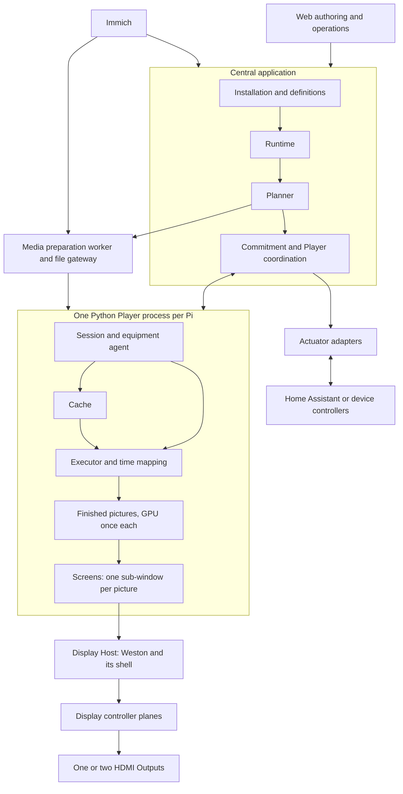

# Architecture

> **Status: proposed architecture.** The [requirements](requirements.md) define product behavior. [Decision 0006](decisions/0006-central-authority-and-stateless-players.md) fixes central durability and the stateless Player boundary; unresolved choices are tracked in [design decisions](design-decisions.md), with delivery work in the [implementation plan](implementation-plan.md).

## System boundaries

Photo Wall owns installation configuration, Scene execution, compatible media assignments, calibration and display history. Immich remains the media library. Build the domain core because persistent Frame locations, live sources, nested Runs, per-target overlays and rolling assignments need one coherent model. Reuse media and infrastructure components around that core. Dependencies must support free, self-hosted deployment.

Start with one modular central application, a Procrastinate media worker, and one Python Player process per Raspberry Pi. PostgreSQL and the task queue exist only in central components. Players render centrally selected media from current timed instructions and retain no authoritative state. Authoring and operations use a web UI.



These are responsibility boundaries, not a service per box. The [execution contract](execution-contract.md) defines preparation, commitment, intended-time execution and feedback to both Runtime and Planner.

## Central modules

| Module | Ownership and interface | Failure responsibility |
|---|---|---|
| Installation registry | Desired topology, bindings, typed target groups and calibration revisions; accepts separate equipment observations. | Retire stale equipment authority while preserving Frame identity. |
| Definitions and activation ingress | Versioned Scenes, sources and Programs; normalize schedules, manual requests and Sensor events into Activation requests. | Reject invalid definitions and deduplicate activation according to the request policy. |
| House time (`central/house_time/`, 2b) | The house's timezone and optional location (Settings › House) and the one calculator of every time of day: a When's windows across midnight, daylight saving and sunrise/sunset ([Runtime](module-runtime.md#house-time-and-repeating-programs)). Pure; Central only (import contract "Sun times and the zone database are Central's"). | A house with no row reads Central's own zone, the seed; a When that needs a location the house lacks is refused, never guessed. |
| Display power (`central/power/`, 2a) | Night off, holds (All off, All on, Resume schedule) and each HDMI port's 7-day power timetable of set times, carried by the Output document ([0021](decisions/0021-power-timetable-and-repeating-schedules.md)). Pure; operational state, never reads a Scene. | The Pi switches on its own clock with Central away until the timetable runs out, then leaves the display as it is. |
| Why (`central/why/`, 2b) | Why is this playing (each Frame's winner, what it beat, its wanted power and what the Pi says) and the week page's data ([execution contract](execution-contract.md#why-is-this-playing)). Pure; it explains, never decides. | Shows the Pi's report as a fact that may lag, or "not heard". |
| Runtime | Active Run tree, logical progression, lifecycle and per-target intent. | Apply execution outcomes to completion/cancellation; preserve current-state semantics during projection. |
| Photo library | Immich connections with write-only keys and their health; Photo source queries and drafts; one pool per distinct query, filled by the media worker's checks ([media module](module-media.md#photo-source-queries)). | A failed or incomplete check removes nothing, so an outage never empties a pool; a connection's problem shows as Needs a look with its fix. |
| Catalog and Planner | Read each Source's whole pool (no window, no cap), enforce compatibility, select assignments and exact variants, project preparation and measurement needs. | Distinguish a Source not yet checked from a truly empty one; revise unsecured work or choose authored fallback. |
| Wall plan (`central/wall_plan/`, 5a) | Pure rules the Planner composes: key content's vocabulary, [the photo fit rule](module-planner.md#the-photo-fit-rule) and its crop, Scene selection settings, [order and passes](module-planner.md#order-and-passes), and [the wall plan](module-planner.md#the-wall-plan): every Frame's photos over the hour, planned together, one photo per Frame, never on two Frames at once. No I/O, clock or database (import contract "The wall plan is pure"); its stores are ports (shown history, key content) implemented in `central/infra/`. | A Frame always keeps content: a repeat or its previous photo before nothing; compatibility and on-screen never relax. |
| Commitment and Player coordination | Sessions, plan revisions, readiness, execution authorization and observation routing. | Reject stale work and apply defined missing-participant/reconciliation policies. |
| Media worker and gateway | The only caller of Immich and reader of a key: check connections and pools in bounded steps; atomically enqueue through Procrastinate, fetch selected photos as Immich shows them, prepare/publish authoritative variants and deliver authorized exact bytes. | Fence stale check steps by number; preserve publication recovery and stale-attempt fences; report acquisition and capacity failures. |
| Provisioning and releases | Recognize equipment observations by serial, offer each node boot the operator's boot selection, and catalogue node releases ([Node control](runbook.md#node-control)). | Bind node sessions to the current boot; a later boot supersedes the earlier one. |
| Peripheral adapters | Normalize Sensor events and execute resolved Actuator intent or equipment commands. | Report failures without independently resolving Scene priority or target ownership. |

Use PostgreSQL for all durable Photo Wall state: installation intent, Runtime/Planner/coordination records, media lifecycle, queue jobs, equipment recognition, and release/trial policy. Modules expose named operations and transaction-bound repository ports; they do not call another domain's private methods or SQL. Typed Pydantic transports cross process/domain boundaries. Psycopg pools own central connections, and atomic operations such as media request plus task defer share the caller's transaction.

### Installation inventory and enrollment observation

The Installation registry owns the complete [typed inventory](../central/installation_models.py) returned by `/v1/operator/inventory`: Players, nested Output observations, and Frames with their profiles, bindings, calibration, and revisions. Its repository selects public fields explicitly, and the HTTP response validates that complete contract. Consumers validate all three collections before projecting the smaller view they need; valid Player rows do not excuse malformed Output or Frame data.

Enrollment observers need only Player ID, Equipment observation ID, authority epoch, and retirement state. Health is eventually consistent feedback and may still be empty when enrollment is visible. It neither supplies identity nor determines whether a new session exists. Output discovery, release-health acceptance, and observed presentation retain their own checks.

The enrollment observation contract permits only `pending` with no session or `ready` with a session. Transport success does not imply readiness. The [appliance harness](module-appliance-e2e.md#enrollment-observation-boundary) owns the expected Equipment, boot, and session-epoch checks for its isolated fixture without adding enrollment policy to the Player.

### Operator console

**Status: built** (pass 2, passes C and D), verified by the tests named below; owner approval of the design's questions 1–6 is pending, and the build uses their defaults. The design and the reasons for each choice are owned by the [flow design](operator-console-ux-pass2-flow.md); how to use it is in the [runbook](runbook.md#operator-console-sections-links-and-drafts). This section is the module map.

The console is a React single-page app in `central/console/`, bundled by Vite and served by Central at `/`. It calls only `/v1/operator/*`, with the session cookie of [pass A](operator-console-ux-pass2-session.md).

**Two planes** ([console design §4a](operator-console-ux-design.md#4a-the-two-plane-state-model)). *Plane A* is one snapshot: inventory, runtime and media read together and swapped whole by the one poller in `useSnapshot.js` (every 5 s while the tab is visible, after each write, and on Refresh). The newest read wins, a read overlapped by a write is dropped, and polls are single-flight; the snapshot status carries `aria-busy` while a read is in flight, so the end of a read is observable. *Plane B* is what the operator is doing: flow drafts, calibration trials and the Wall's memory. A refresh never merges into it.

**The shell** (`Shell.jsx`). `routes.js` parses and formats the hash routes and has no React; `useRoute.js` is the only writer of `location.hash`. Sections come from three route tables:
- `showRoutes.jsx` (Now, Scenes, Schedule, Sources): always mounted. The pages that are not current carry the HTML `hidden` attribute, so a draft never unmounts and their status regions leave the accessibility tree. Each page tells its subtree whether it is hidden (`pageVisibility.js`), and `ConfirmAction` puts a hidden page's modal dialog away.
- `wallRoutes.jsx` (Wall, Equipment): mounted only while current. The Wall state that must outlive the page lives in `wallState.js`, which imports no component.
- `neutralRoutes.jsx` (Needs attention): mounted only while current.

The shell is keyed on the provider's `sessionEpoch`, which Log out bumps, so Log out remounts it and discards every draft. A 401 while signed in keeps the snapshot and leaves the shell mounted, `hidden` and `inert`, under the sign-in `<dialog>` (`SignInScreen.jsx`), with the poll paused ([flow design §6](operator-console-ux-pass2-flow.md#6-navigation-routes-and-modules) (a)–(e)).

**R4: Calibration controls only from the Wall.** Because Wall pages mount only while current, no hidden page holds Calibration facet DOM. The guarantee is a CI test, not a runtime check. `tests/test_console_routes_r4.py` takes the module graph from the bundler (esbuild's metafile), cross-checks it module by module against its own import scan (a disagreement is an error, so JSX text that fools the scan cannot hide an import), and fails if `showRoutes.jsx`, `neutralRoutes.jsx`, or `main.jsx` stopping at `wallRoutes.jsx` reaches the Wall-only closure (everything the Wall table reaches but the shell's own modules and a declared, checked list shared with the Show side), or if a Show or neutral module names the calibration route. The scan fails closed: an import it cannot read or resolve is an error; without Node or esbuild the test fails where the checks must run. `tests/browser/test_console_shell_browser.py` visits every sample path of the Show and neutral tables (`routeSamples.json`) and finds no Calibration facet landmark.

**The flow kit** (`central/console/src/flow/`). Every step flow is built from it:
- `useFlowDraft`: one draft per flow, keyed `new` or `edit/<id>`, with `baseRevision` for stale detection and `reseed` for Reload. Opening another key while the draft is dirty is refused.
- `useFlowInstance`: the route's instance, step normalisation, Continue scoped to its step, `checkAll` for the final write, Back, the in-app start with its discard confirmation, and `finish`, which replaces the flow's history entry only if the location still names it.
- Hand-offs (`handOff.js`, `useHandOff.js`): the shell holds one pending hand-off; the Scene flow begins one to the Source flow, which settles it once, with its result or with nothing.
- Views: `Stepper`, `StepForm`, `Advanced`, `CheckAnswers`, `SummaryCard`, `InstanceNotice` (with `DraftBar` and `HandOffNotice`), plus `useFlowFocus`. The pure modules (`draftState.js`, `steps.js`, `instance.js`, `handOff.js`) are run under Node by `tests/test_console_flow.py`.

Each flow container keeps its own seed, draft effects, write and step views, beside a pure model: `SceneFlow.jsx` (`sceneFlowModel.js`), `ProgramsRegion.jsx` (`scheduleFlowModel.js`) and `ShowNowFlow.jsx` (`showNowModel.js`, with `coveringPriority` in `showState.js`). A Photo source is not a step flow: `SourcesRegion.jsx` opens the one-page Photo source editor (`pages/photo-source-page.tsx`), whose unsaved draft is a draft row in Central (roadmap 4), so its check runs before Save. The shell's context also carries `recentScene` (`{sceneId, seq}`: each hand-over is an event, so the same Scene handed over again is offered again), which prefills Schedule and Show now, and `markDraft`, which puts "Draft" in the sidebar.

**The look.** The tokens in `index.css` take their values from the photo library's published theme, in both colour schemes. Only values are reused, never code, markup or assets. Some are darkened for WCAG AA, and `tests/test_console_look.py` checks every contrast pair. The text face, "Console Sans", is a Latin-1 subset of the Google Sans variable font, renamed as its trademark notice requires for a modified version and shipped with its SIL OFL 1.1 licence (`central/console/src/fonts/README.md`). Everything is bundled and same-origin, so the CSP is unchanged. Vite's `assetsInlineLimit: 0` keeps assets out of the `data:` URLs the CSP refuses. Central registers `font/woff2` because Python 3.12's built-in MIME table lacks it (`central/app.py`). `tests/browser/test_console_look_browser.py` checks the served type and that the face loads.

## Player and rendering

The current Player application is one rendering process. Its session module holds only current plans/configuration and a fresh authority epoch; the equipment agent reports Outputs; the disposable cache secures exact bytes; the executor owns local app action; and the Renderer owns decoding, app composition, effects and calibration geometry. A Player app has no database, durable identity, execution journal, update slots or authoritative cache metadata. Diagnostics collect current observations. Weston, clock discipline and process supervision remain OS services. The [Player node domain target](player-node-domain-model.md) assigns final scanout and the privileged diagnostic to base-owned DisplayHost, host observation/reboot to independent HostCore, and app mutation to AppEffectBroker; the app still has one rendering owner within its own domain.

Embed GStreamer through Python/PyGObject rather than launching a media-player executable. Python orchestrates; the GPU, the hardware video decoder and the display controller handle every pixel, with no Python pixel-processing loops. Nested Runs need not map to nested pipelines or processes.

**Finish once, show as a plane** ([0029](decisions/0029-render-planes.md), [plane renderer](module-plane-renderer.md)). Each Frame's photo, or each decoded frame of its video, is finished once by the GPU at the smaller of its source's cropped size and the Frame's pixels, already turned for its screen, with the whole look; the Pi's display controller shows each finished picture as its own display plane, enlarged to the Frame when smaller, and mixes its fade every refresh, with no GPU:

```text
decode (stills once; HEVC in hardware, per frame)
  → fit pass: the crop window, scaled to the finish size (never above the Frame's pixels), turned for the screen,
    the look (the paper under the room's light, the LUT, the Display's software settings)
  → composition: each seen layer a plane, bottom to top, at its strength, within the controller's budget
  → one commit per screen: the ground, then the planes → the display controller → HDMI
```

The Player Renderer is the single owner of the Frame's geometry and the only picture pipeline: Display Host carries picture settings, turns the screen and talks to the display over DDC/CI, but never computes a Frame's geometry or adjusts pixels (an import-linter contract keeps `appliance` from importing `contracts.frame_fit`). Calibration is not baked into source media. A Frame's Position and turn survive equipment replacement, while output mappings and Panel-specific correction may require revalidation.

**A Frame's Position: one upright rectangle.** A Frame's picture sits on its screen as one upright rectangle of its Frame display profile's aspect (`width_px : height_px`): its centre and width as fractions of the screen as it hangs, its height from the aspect ([`contracts/frame_fit.py`](../contracts/frame_fit.py) `FrameRectangle`, the Position form `RectangleFit` in [`contracts/models.py`](../contracts/models.py)). `place` turns it into whole pixels by rounding half up, and refuses a rectangle that does not lie wholly on its screen, never clipping it; Central sizes photos by those pixels (`frame_output`), the Player places the plane there, and the console judges an edit by a tested mirror of the same rule. No corners, perspective or angle (owner, 2026-10-17: "We can make the position pure crop and scale"). The aspect alone is the Frame's orientation (owner, 2026-10-11: ""landscape" and "portrait" are descriptions of the aspect ratio. whereas the angle of rotation is a quality of the way frames are hung on the wall, or possibly some unique conditions of how displays are mounted within the matte"). The photo is cropped once, to the window its layer's crop names: the profile's aspect, slid along the photo's free axis to the offset Central chose (`Layer.crop`, [`contracts/photo_crop.py`](../contracts/photo_crop.py) `crop_window`; [execution contract](execution-contract.md#what-a-frame-shows-its-crop-and-when-a-photo-is-on-screen)), and stretched over the rectangle. The Player never chooses a crop.

**How the screen hangs: the turn.** A screen turned sideways is turned as a whole, in quarter turns: 0, 90, 180 or 270 degrees clockwise ([`contracts/display_turn.py`](../contracts/display_turn.py); owner, 2026-10-17: "Rotation is really just for the case where a display is turned sideways"). The turn belongs to the spot on the wall (owner, gate answer Q3, 2026-10-17): it is stored on the Frame, sent in its Output's document, and carried out by Display Host as Weston's output transform. The Player draws each picture already turned and commits it with the matching buffer transform, so Weston shows it on a plane with no copy; the display controller cannot turn a picture a quarter turn itself. Every Frame on one screen shares its turn.

**Outside every Frame stays black.** Each screen's ground, beneath the planes, is opaque black, and a Frame draws nothing outside its rectangle, so no picture setting, mat shadow or fade lifts the black outside the Frames. The picture operations are per Output (per Display), applied by the fit pass to every Frame on it, in the order [0028](decisions/0028-room-light.md) owns (scalar reference [`player/geometry.py`](../player/geometry.py) `final_pixel`). One Frame per screen today (owner, gate answer Q4, 2026-10-18: several "later"); a composition is already a list of planes, so several Frames per screen need Central, the console and the grants per Frame, and the controller budget then shared, not a new renderer. Design preview/commit/revert separately from ordinary playback and configuration adoption. A known SDR working space and disabled audio are recommended initial simplifications; expanded color and audio behavior require explicit scope decisions.

Keep every renderer call on the Player's GLib main thread, following [PyGObject threading guidance](https://pygobject.gnome.org/guide/threading.html): GStreamer's streaming threads only hand a frame over. Downloads, disk validation and conversion must not block it. Two Outputs, overlays and cross-fades share the Pi's display controller budget, GPU, decoder and memory; the budget is checked before every screen update, because the Pi 5's controller glitches rather than refuse an overload.

## Media preparation and cache

Hide [Immich API](https://api.immich.app/) contracts behind one adapter in the media worker (`media/immich.py`) with a tested release (2.5.x) and a note for newer ones. Immich does the matching: each Photo source is one Immich query, and each exclusion one more, which Photo Wall subtracts. The worker reads every wanted query into its **pool** in short, separately queued steps by keyset pages, with no membership ceiling; a check adds what it confirms and removes photos only when it completes, so an outage or a rejected key never empties the wall. Check cadence, planning lookahead and cache retention are separate settings. New matching photos affect future uncommitted assignments; query edits follow authored-revision policy (Save makes the Source's next revision). See the [media module](module-media.md#live-discovery-pagination-and-metadata) and the [media worker](module-media-worker.md#connection-and-pool-checks).

Check the photo fit (the ratio of its sides, its key content kept, its pixels) and quality before preference ranking, then verify the chosen presentation variant. The media worker measures each photo's key content (Immich's face boxes and an interest grid from the small thumbnail) ahead of planning; the [photo fit rule](module-planner.md#the-photo-fit-rule) judges it. Upscaling cannot make an ineligible original qualify. Preparation fetches the photo as Immich shows it, edits included: Immich's preview when the window of each Frame's shape cut from it holds that Frame's pixels, else Immich's full-size copy, then converts it to Photo Wall's recipe. Cache selected originals/variants centrally, with stable content identities and integrity metadata.

Central's on-disk served assets — photo media (a cache of Immich), the Player `.deb` and the OS squashfs (caches of GitHub Releases) — are **one disposable cache** the worker owns and Kubernetes places: a single `PHOTO_WALL_CACHE_ROOT` (baked default) whose `media/`, `apps/`, and `os-images/` subdirs are derived as internal constants, mounted RW on the worker (the single writer) and RO on central. The filesystem is a cache and the database is intent, so every read tolerates a miss — a lost or evicted file regenerates from its source of truth on the next request. Release sourcing and base serving are always-on; each domain bounds itself with a GC and a filesystem orphan sweep, and `os-images` self-heals a dangling `cached` row and keeps a reserved floor so nothing starves netboot. See the [Central cache subsystem](module-central-cache.md) and [decision 0013](decisions/0013-unified-cache-root.md).

Push upstream-neutral manifests and intent through the control channel; let Players pull authorized files from the central show system's gateway over HTTPS, preserving the [central media boundary](requirements.md#central-media-boundary). The gateway resolves upstream identities and supplies bytes itself. Downloads occur ahead of activation, including explicit standby preparation when configured.

Use bounded temporary files with an in-memory cache index and process-local pins. An optional cache directory may survive restart, but every candidate is untrusted until its content-addressed name, exact size, and SHA-256 are revalidated. Never evict a file pinned by current process authority. Release pins when current work no longer needs them; a month-long Run does not pin its history. Cache deletion or corruption invalidates local readiness and triggers reacquisition of the same centrally secured assignment. It never causes reenrollment or a new selection. File acquisition and imminent decoder preparation remain distinct resource budgets.

## Credentials and operational state

Generate a fresh process key and credentials at startup, scoped to current configuration, authorized media, and reporting endpoints. Trusted provisioning observations such as Pi serial or MAC can help central recognize equipment; they are operational matching information, not cryptographic identity. PostgreSQL maps recognized equipment to persistent records and operator-owned Frame bindings. Apply least privilege to the [central media integration](requirements.md#central-media-boundary): an Immich key is read-only by permission, written once through the operator API, kept in Central's database and read only by the media worker ([decision 0020](decisions/0020-immich-key-in-central-database.md)). Authenticate administrators separately, encrypt network channels, and scope MQTT credentials so a Player cannot issue arbitrary home-control commands.

Maintain desired configuration revisions separately from observed/applied state. A report must not overwrite operator intent. Enrollment, claim/retirement, credential rotation and replacement recovery need an explicit trust workflow. Bindings authorize Outputs to serve persistent Frames; a replaced Player must not regain control using an old instruction.

Keep maintenance, blanking, Panel power, Player shutdown, reboot and updates distinct from authored Scene state. Respect power dependencies and graceful shutdown where required. [Home Assistant's WebSocket API](https://developers.home-assistant.io/docs/api/websocket/) and NATS (the Galleria integration, [0028](decisions/0028-room-light.md#home-assistant-on-centrals-hub-2026-10-16)) are integration options for selected controls and observations; they are not the source of truth. Scene definitions address logical Actuators rather than vendor commands.

## Appliance operation

The [Player node domain model](player-node-domain-model.md) is the target boundary for HostCore, AppManager, AppEffectBroker, Display Host and the replaceable Player. It supersedes the single-agent/data-only target described in earlier fleet proposals. The paragraphs below identify the existing PXE/deb path where they describe current code; it does not yet provide the proposed host-continuity or display guarantees.

Implement [automatic Player provisioning](requirements.md#player-provisioning) with one common Ubuntu 24.04.4 Raspberry Pi arm64 image delivered over PXE, following the [accepted platform decision](decisions/0005-native-platform-and-registration-fallback.md). Use the [Raspberry Pi network-boot documentation](https://www.raspberrypi.com/documentation/computers/remote-access.html#network-boot-your-raspberry-pi) to define the supported hardware precondition. The bootstrap obtains a central release ticket, verifies and copies the selected rootfs into RAM, and needs no writable persistent volume.

Boot establishes trusted time and networking, asks central to recognize the equipment observation and select a release, then enrolls a fresh Player session and restores current central bindings/configuration. Unknown equipment remains visible and unbound. Cold boot requires provisioning, release, enrollment, control, and media connectivity. The existing base-trial path can reboot after a failed trial; the proposed HostCore separates operator-requested immediate reboot from the still-open automatic recovery-reboot policy. Fresh matching-boot/session evidence is required before any new acceptance claim.

Every boot stage reaches the configured Central the same way ([decision 0014](decisions/0014-reaching-central-from-every-boot-stage.md)). The netboot initramfs is the first user. It reads Central's root from `photowall.central=`. It then locates Central with one credential-free `GET /v1/locate`, following up to ten redirects across hosts. Each hop is checked before anything is sent to it: a redirect from https to http, a changed path, a loop or an eleventh hop is refused ([`tests/test_uplink_redirects.py`](../tests/test_uplink_redirects.py), [`tests/test_uplink_locate.py`](../tests/test_uplink_locate.py)). Central answers `/v1/locate` with its identity, `{"service":"photo-wall-central","api":1}`, marked `Cache-Control: no-store`. The route is declared beside `/healthz` and needs no database, so it answers even while Central reports itself unhealthy ([`tests/test_central_locate.py`](../tests/test_central_locate.py)). The identity is a misconfiguration check, not authentication. Every https hop is verified against the one CA bundle the build copied from the base, with the host name checked on each hop ([`tests/test_uplink_tls.py`](../tests/test_uplink_tls.py)). The origin of the URL where locate ends is the only place direct requests go, and a direct request refuses any redirect ([`tests/test_uplink_fetch.py`](../tests/test_uplink_fetch.py)). Every failure is exactly one named cause (R9; [`tests/test_uplink_causes.py`](../tests/test_uplink_causes.py)). This logic lives in the top-level `uplink` package. `uplink` uses only the standard library and the stdlib-only `contracts` modules, because it runs inside the initramfs. That rule is enforced when the `photo-wall-netboot-init` package builds (`scripts/import_check.py`, [Debian packaging module](module-debian-packaging.md)) and by importing the hook's tree under `python3 -I -S` ([`tests/debs/test_netboot_init.py`](../tests/debs/test_netboot_init.py)); the import-linter contract only warns early. The Player adopts `uplink` in a later project and keeps its own HTTP clients until then.

Provisioning and the Player resolve the same command line, locate the same way, and go direct to the located origin: the Player's `httpx` and `websockets` clients are built from one Trust, with no redirects. The Node's software is built as Debian packages by one source package ([Debian packaging module](module-debian-packaging.md), [0019](decisions/0019-debian-packaging-with-debhelper.md)): the base installs `photo-wall-node` and the contexts it pins from a local repo, and the Player and AppManager run from release roots, squashfs images that `mmdebstrap` resolves from the Debian snapshot pin and the same repo, so each root's dependencies are resolved and sealed in the release build, never on the Pi. The earlier path, a provisioner that installed the Player `.deb` with `dpkg` against the host root, is deleted. A new typed artifact schema and base ABI gate prevent old boot trees from interpreting those bytes as the current data-only payload.

Ordinary Scene/media changes preserve windows and valid content or configured fallback, without exposing OS UI or resetting HDMI mode. Recoverable playback failures should preserve the visible composition. In the target design, a base-owned Display Host keeps an error/identity page available when the app is absent and arbitrates diagnostics above app surfaces; a one-time first buffer is insufficient for sustained handoff. The current kiosk host can show black after a native Player crash, so this remains unimplemented. Last-picture retention across that crash would require another mechanism. Test compositor, GPU, power and panel startup behavior separately; software presentation evidence does not prove physical pixels.

Health must describe presentation, not just a live process: current bindings/revisions, Runs and visible media, readiness, cache pressure, clock uncertainty, scheduled/observed timing, dropped/late frames, decode failures, thermals and recent faults. Keep diagnostics remotely accessible and use physical [validation](validation.md) for output continuity and synchronization claims.

## Component choices

| Responsibility | Starting point | Qualification focus |
|---|---|---|
| Central API and persistence | [FastAPI/Pydantic](https://fastapi.tiangolo.com/features/), [PostgreSQL](https://www.postgresql.org/docs/current/tutorial-transactions.html), Psycopg pooling, [Procrastinate](https://procrastinate.readthedocs.io/). | Domain ownership, atomic task defer, durable execution and restart behavior. |
| Media | [FFmpeg/ffprobe](https://ffmpeg.org/ffprobe.html), [libvips](https://www.libvips.org/). | Exact variant profiles, source fidelity and conversion lead time. |
| Player | [PyGObject](https://pygobject.gnome.org/), [GStreamer](https://gstreamer.freedesktop.org/documentation/) (V4L2 stateless HEVC decode), EGL and GBM, GLES 3 through PyOpenGL, Wayland through the frame client. | Independent Outputs, fades, seeks and capacity; planes, plane alpha and hardware decode are proven only on a Pi ([render bench](runbook.md#the-render-bench-and-pi-testing-before-merge)). |
| Disposable cache | Content-addressed temporary files plus in-memory metadata. | Complete verification, bounded pressure, deletion/corruption recovery, optional byte reuse. |
| OS services | Weston with Photo Wall's shell ([display host](display-host-backend.md)), [chrony](https://chrony-project.org/), [systemd service reference](https://github.com/systemd/systemd/blob/main/man/systemd.service.xml). | Output routing, clock mapping, watchdogs and boot/crash continuity. |
| Image build | [rpi-image-gen](https://github.com/raspberrypi/rpi-image-gen). | Pinned artifact, provisioning, enrollment and rollback. |

Qualify the exact combination before fixing production media or timing guarantees. Change profiles, composition paths or equipment allocation if measurements require it while preserving the domain and execution contracts.
