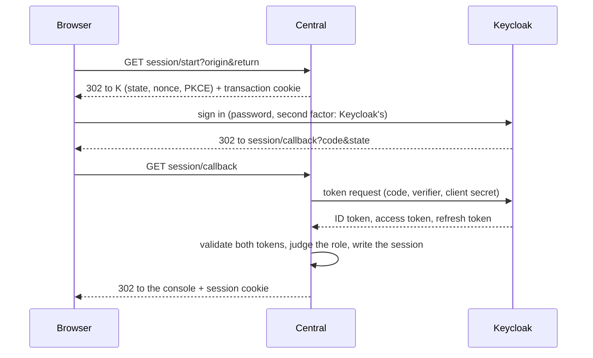

# 0035 — Operator sign-in through an identity provider (Keycloak)

**Date:** 2026-11-22 · **Layer:** module (Central's operator access: who may call `/v1/operator/`, and who changed a record) · **Status:** accepted design (owner, 2026-11-22: "I'll take your recommendations. Proceed"), being built. It is slice 1 of [roadmap 3b-i](../roadmap.md#3b-i-home-and-phone); slices 2 and 3 are [0036](0036-home-frame-status-and-wall-actions.md). **Replaces:** the token sign-in of [pass A](../operator-console-ux-pass2-session.md) wherever a provider is configured.

**Decision owner:** the owner. His words below are his; everything not quoted from him is a design choice, not his ruling.

## The owner's words

| # | Words | Source | Kind |
|---|---|---|---|
| G1 | "When it comes to signin, I want keycloak compatibility" | owner, 2026-11-22 (chat) | guidance |
| Q1 | Accounts: "OIDC only": Central is a relying party and stores no passwords; the deployment injects the provider; with no provider configured, today's token sign-in stays as the only fallback | owner, 2026-11-22 (question card) | a pick, revisable |
| Q2 | Machine access: "No opinion. Is this like a service account?" | owner, 2026-11-22 (question card) | no ruling; the design's choice is [below](#machines-service-accounts) |
| Q3 | Authorization: "A required role": one role from a configurable claim, the same claim later carrying member and guest roles | owner, 2026-11-22 (question card) | a pick, revisable |
| R1 | "I'll take your recommendations. Proceed": every default of this record's open questions and findings stands as the owner's pick | owner, 2026-11-22 (chat) | a pick, revisable |
| — | "The immich url and api key should be injected by iac" | owner, 2026-10-12 | guidance, applied here to the provider's settings |

## The problem

Central has one operator credential, `PHOTO_WALL_ADMIN_TOKEN`. A browser pastes it once and gets a signed cookie that names nobody ([pass A](../operator-console-ux-pass2-session.md)). Three things follow:

- **Nobody is anybody.** Every audit field (`*_by`) holds `console` or `api-token`. A power hold "by the console" cannot say who set it, and 0036's Pause and Show now need that.
- **A phone needs a 64-character secret pasted into it.** Roadmap step A2 asks for an account.
- **One secret for people and machines.** Changing it signs out every browser and breaks every script at once.

## Decision

**Central is an OpenID Connect relying party and a resource server, and keeps no passwords.** Accounts, passwords, second factors, lockout and password reset belong to the provider. Keycloak is the provider Central is tested against; nothing in Central's code names it.

1. A person signs in with the authorization code flow and PKCE. Central, a confidential client, exchanges the code itself. The browser never holds a provider token.
2. Central then keeps its own session, one row, and gives the browser an opaque cookie.
3. A machine sends the provider's access token as `Authorization: Bearer`. Central validates it as a resource server.
4. **One judge for both.** A person and a machine are let in by the same rule: a valid access token from the configured issuer that carries the required role. The rule has one home.
5. With no provider configured, Central runs exactly as today (token sign-in). This is the fresh-install and test mode.

### What is given up

- **A provider whose access tokens are not signed JWTs is not supported.** Keycloak's are. Reading roles from the access token is what gives people and machines one judge, and it is where Keycloak puts roles by default. A provider with opaque access tokens would need a second judge reading the ID token; that is not built.
- **Session length is the provider's**, not setting #138. Central only caps it.
- **Sign-in needs the provider.** When Keycloak is down nobody new signs in. The wall keeps playing, sessions already open carry on (below), and the break-glass token still works.
- **Home Assistant's door on the hub stays without a secret** ([0028](0028-room-light.md#home-assistant-on-centrals-hub-2026-10-16)). This decision covers `/v1/operator/` only. The Player, enrollment, media, netboot and Node bus planes do not change.

## The model

A new pure package, `central/operator_access/`, owns the vocabulary and every rule. It imports no HTTP client, database, FastAPI or JWT library.

```
Principal
 ├─ Person      operator_id · name · roles · session_id      (a cookie)
 ├─ Machine     operator_id · name · roles                   (a provider access token)
 └─ BreakGlass                                               (the environment token)

Role        = "owner"                      # the one role today; #136 adds more
Permission  = "read" | "operate" | "configure"
```

- **`operator_id`** is Central's own short id for a provider identity `(issuer, subject)`. A person's is their user; a machine's is its service account. Central never keys anything by a name or e-mail, which the provider may change.
- **Roles come from one claim.** `roles_in(claims, path) -> frozenset[Role]` reads a dotted path, by default `resource_access.<client id>.roles`, Keycloak's client roles. Unknown role names are ignored, never an error, so the realm can carry roles Central does not know yet.
- **Permissions are what routes ask for.** `allows(roles, permission) -> bool` is the one policy table. Today `owner` has all three. Every existing route keeps its dependency, `admin`, which now asks for `read` on a read method (GET, HEAD, OPTIONS) and `configure` on any other, so none of its 123 uses changes. A second dependency, `operate`, is for the everyday actions. 0036's everyday actions (Skip, Pause, Show now, Never show, All off and on) ask for `operate`. This is the seam Q3 asked for: a guest role that may only `read` and `operate` is one row in the table and one mapper in Keycloak, with no route touched.
- **`BreakGlass` holds every permission** and is named in audit as `api-token`, as today.

### Who changed a record

`central/actor.py` stays the one home of audit values. `Actor` stops being a closed list of seven words and becomes a small grammar, still one `TEXT` value, so no audit column changes type:

| Value | Meaning |
|---|---|
| `person:<operator_id>` | a signed-in person through the console |
| `client:<operator_id>` | a machine with a provider token |
| `console` | the console in token mode (no provider), as today |
| `api-token`, `scheduler`, `library-check`, `node`, `central`, `home-assistant` | unchanged |

`actor.py` owns `encode` and `parse`; no other module splits the string. A reader that shows "who" (a hold's banner, a History entry) asks the operators repository for the name. Rows written before this delivery keep `console`.

### What Central keeps

Two tables, each one aggregate with one repository ([0034](0034-central-schema-consolidation.md)):

| Table | One row per | Holds | Written when |
|---|---|---|---|
| `operators` | provider identity | `operator_id`, issuer, subject, kind (person or client), name as last stated, audit fields | first sight, and when the stated name changes |
| `operator_sessions` | signed-in browser | the cookie value's SHA-256, `operator_id`, the sign-in Origin, the provider's session id (`sid`), the roles last judged, when that judgement stops being fresh, the refresh token and ID token, the hard end | sign-in; each re-judgement that changes something; Log out |

- **No write per request** ([0033](0033-central-write-load.md)). A request reads its session row; it writes only when the judgement is re-made (below).
- **The refresh token is a secret at rest**, like the Immich key ([0020](0020-immich-key-in-central-database.md)): one repository reads it, no route answers it, no log line carries it.
- Ended sessions are deleted in bounded batches by the existing retention loop (`infra/batched_retention.py`).

## The protocol

### Routes

All under `/v1/operator/session`, so the existing cookie path and the `no-store` rule cover them.

| Route | Who calls it | Does |
|---|---|---|
| `GET /v1/operator/sign-in` | the console, signed out | Unauthenticated. Answers how to sign in: `{"method": "provider", "name": "<provider name>"}` or `{"method": "token"}` |
| `GET /v1/operator/session/start?origin=…&return=…` | the browser, as a navigation | 302 to the provider's authorization endpoint with `state`, `nonce`, a PKCE S256 challenge and `scope=openid` |
| `GET /v1/operator/session/callback?code=…&state=…` | the provider's redirect | Exchanges the code, judges, creates the session, sets the cookie, 302 to the console at `return`. A sign-in that fails lands on the console with `?sign_in=` and one of `not_allowed`, `provider_unreachable`, `failed`, which the sign-in page words |
| `GET /v1/operator/session` | the console | Who am I: name, roles, provider name. 401 when signed out |
| `DELETE /v1/operator/session` | the console's **Log out** | Deletes the row, clears the cookie, answers the provider's end-session address to go to |
| `POST /v1/operator/session/backchannel-logout` | the provider | OpenID Connect Back-Channel Logout: ends every session with that `sid` |
| `POST /v1/operator/session` | the console in token mode | Today's token sign-in. Answers 404 when a provider is configured |
| `GET /v1/operator/access` | Settings › People and access | The provider's name, its host, whether Central reaches it and when it last did; the 30-day ceiling |

### Sign-in



- **The transaction** (state, nonce, PKCE verifier, origin, return route) travels in a cookie Central seals with AES-GCM, ten minutes long, `HttpOnly`, `SameSite=Lax` (the provider's redirect back is a cross-site navigation), path `/v1/operator/session/`. Nothing is written to the database for a visitor who never finishes.
- **The redirect address** is `<origin>/v1/operator/session/callback`, built from the origin the console states at `start`. Central does not need to know its own public address: the provider refuses any redirect address not registered on the client, exactly.
- **`return`** is a console hash route only (it must start with `#/`); anything else lands on Home.
- **The session cookie keeps pass A's shape**: the same names by scheme, `HttpOnly`, `SameSite=Strict`, path `/v1/operator/`, no `Domain`. Its value is 256 random bits; the row holds only its hash.
- **A write authorized by the cookie keeps pass A's three checks**: the console's marker header, the sign-in `Origin`, and `Sec-Fetch-Site: same-origin` when sent.

### Validating a token

One pure function judges a token given the issuer's keys and the clock; the adapter only fetches.

- The signature must verify under a key from the issuer's JWKS. Algorithms are an allow-list (RS256, PS256, ES256); `none` and the HMAC family are refused whatever the provider metadata says.
- `iss` equals the configured issuer exactly. `exp` and `nbf` are read on Central's clock with 60 s of leeway.
- **A token is addressed to Central** when its `aud` contains Central's client id, or its `azp` (the party it was issued to) is Central's client id. Only Central, holding its client secret, is issued a token as its own client. Both arms are needed for Keycloak's defaults: a person's access token, issued to Central's client, carries `azp` and an `aud` without that client, because Keycloak's audience mapper leaves the requesting client itself out; a service account's token is issued to its own client and carries Central's client in `aud` while it holds one of Central's client roles. (The first draft of this record asked for `aud` alone; the real-Keycloak leg showed that an owner could then not sign in without an extra mapper in the realm.)
- **ID token:** addressed to Central, and its `nonce` equals the transaction's.
- **Access token:** addressed to Central, and not an ID or logout token ([as built](#as-built)).
- An unknown key id refetches the JWKS once, at most once a minute, then refuses.

### Staying judged

A session is not a 30-day promise made at sign-in. It is re-judged as often as the provider's access token expires (five minutes by Keycloak's default).

- When a request arrives and the session's judgement is no longer fresh, Central uses the refresh token once (one refresh per session at a time), validates the new access token and re-judges the role.
- **The provider refuses** (the user was disabled, the realm session ended or timed out, the role is gone): the session ends and the console shows the sign-in dialog.
- **The provider does not answer:** that is not a refusal. The session carries on with its last judgement and tries again a minute later.
- **The hard end:** 30 days after sign-in, whatever the provider says. This is the old setting #138 as a ceiling.
- **Back-channel logout** ends a session at once when Keycloak says so (an admin's "sign out", Log out in another application of the realm), without waiting for the next refresh.

### Log out

`DELETE` deletes the session row and clears the cookie. The console then goes to the provider's end-session address with the kept ID token as its hint, so the provider's own session ends too and comes back to the console's sign-in page. Without that, the next **Sign in** would pass straight through.

### Machines: service accounts

Yes, this is a service account. In Keycloak, a script gets its own client with service accounts on, is granted the role on Central's client, and asks for a token with the client-credentials grant:

```
token = POST <issuer>/protocol/openid-connect/token  (grant_type=client_credentials)
GET /v1/operator/…   Authorization: Bearer <token>
```

A Bearer header still decides alone, as in pass A. Central reads it in this order:

1. The break-glass token is set and the bytes equal it (constant time): `BreakGlass`.
2. A provider is configured: validate it as an access token and judge the role: `Machine`, or 401.
3. Otherwise 401.

**The break-glass token** is `PHOTO_WALL_ADMIN_TOKEN`. In token mode it is required, as today. With a provider it is optional: set, it keeps `curl`, the calibration reader and the demo working when Keycloak is down; unset, only the provider lets anyone in. It never signs a browser in when a provider is configured.

### Configuration

Set by the deployment in Central's environment, never in the console, never in the database:

| Variable | Meaning | Default |
|---|---|---|
| `PHOTO_WALL_OIDC_ISSUER` | The issuer, for Keycloak `https://<host>/realms/<realm>`. Setting it turns provider mode on | unset: token mode |
| `PHOTO_WALL_OIDC_CLIENT_ID` | Central's client | required with the issuer |
| `PHOTO_WALL_OIDC_CLIENT_SECRET` | Central's client secret | required with the issuer |
| `PHOTO_WALL_OIDC_ROLE` | The role that lets someone in | `owner` |
| `PHOTO_WALL_OIDC_ROLES_CLAIM` | Dotted path to the list of roles in the access token | `resource_access.<client id>.roles` |
| `PHOTO_WALL_OIDC_NAME` | What the sign-in button calls the provider | the issuer's host |

A partial setting (an issuer without a secret) stops Central at start with one line naming what is missing. Central reads the provider's metadata (`/.well-known/openid-configuration`) at first use and again when a call fails; a provider that is down at Central's start does not stop Central.

## Module map

| Path | Owns |
|---|---|
| `central/operator_access/model.py` | `Principal`, `Role`, `Permission`, the session and transaction shapes, the one refusal vocabulary |
| `central/operator_access/policy.py` | `roles_in`, `allows`, token validation given keys and a clock, the Bearer order, freshness and the hard end, pass A's write checks |
| `central/operator_access/ports.py` | `IdentityProvider` (metadata, keys, exchange, refresh, the end-session address), `Sessions`, `Operators` |
| `central/infra/oidc_provider.py` | The one OpenID Connect client (httpx): the only module that speaks to the provider |
| `central/infra/operator_session_store.py` | `operator_sessions`, `operators` |
| `central/operator_auth.py` | The FastAPI side: the routes above and the two dependencies, `admin` and `operate`; token mode and provider mode are two strategies behind one interface |
| `central/operator_session.py` | Unchanged: token mode's signed cookie, exactly as [pass A](../operator-console-ux-pass2-session.md) built it. The first draft of this record moved token mode onto session rows too, for one session path; it stays as it is so that a Central with no provider behaves, and is tested, exactly as before |
| `central/actor.py` | The audit grammar |

- **Import rule:** a new import-linter contract, "Operator access is pure". Only `central.app` and `central.operator_auth` import `central.infra.oidc_provider`.
- **New dependency:** PyJWT with its `cryptography` backend (`cryptography` is already pinned). JWT validation is not written by hand. Authlib was the alternative; it brings a second HTTP client and a framework integration Central does not use.
- **Substitution:** tests run against `FakeProvider`, which implements `IdentityProvider`, and against a real Keycloak. One conformance suite holds both to the same behaviour, as the library store's does.

## The console

Specs follow the [console-ux](../../.claude/skills/console-ux/SKILL.md) template.

## A2 Sign in — UX spec

**Object and home:** none (the house's door) · Sign-in page (settings catalogue #135)
**Template:** listed exception (standalone form outside the shell) · **Save model:** Action · **Delivery:** 3b-i, slice 1

**Layout:**
- First load, signed out: the page title "Sign in to Photo Wall", one `Button` "Sign in with <provider name>", which navigates the whole page to `session/start`.
- Signed out while the console is open: the same content in today's modal `<dialog>` over the hidden, inert shell. Its button opens `session/start` in a new tab, so the shell and every draft stay mounted. The dialog reads the session every 2 s while shown and closes when it is signed in.
- Token mode: today's "Operator token" `Field` and "Sign in", unchanged.

**Settings:** none.

**States:** Loading: the button busy while `GET sign-in` is read · Empty: none · Error: Central did not answer (`ProblemCard`, Retry) · Can't tell: none · Feature states: provider did not answer → "Can't reach <provider name>. Photo Wall keeps playing. Try again."; signed in at the provider but no role → "Your account is not allowed to use Photo Wall. Ask for the owner role in <provider name>."; the browser kept no cookie → today's "allow cookies" line; session ended → "Signed out: your sign-in ended. Sign in again." with "Your unsaved work is kept until you sign in again."
**Live behaviour:** none; the dialog's 2 s read is the listed exception to push while signed out.
**Copy:** "Sign in to Photo Wall", "Sign in with <provider name>", "Log out". Never "token", "OIDC", "claim" or "realm" outside Details.
**Phone:** the same single column; the button is full width and 44 px high.

**Patterns:** reused `Button`, `ProblemCard`, the sign-in dialog · changed `SignInScreen` (method from Central) · new `Input` only for token mode, as the design language already plans.
**Stories:** SignIn/Provider, /ProviderOverlay, /Token, /NotAllowed, /ProviderUnreachable, /Phone.
**Acceptance:** moment of truth none · automated: below · bench: none.
**Departs from DL §8 row:** yes. "wrong password inline, without saying which part was wrong" no longer applies: Central never sees a password. The row's error cell becomes the two feature states above, and its status cell stays "lands on Home".

## A2 Owner account — UX spec

**Object and home:** House · Settings › People and access (settings catalogue #135, #137, #138)
**Template:** T8 Settings area · **Save model:** none (read-only) and Action (Log out) · **Delivery:** 3b-i, slice 1

**Layout:**
- `SettingRow` "Signed in as": the person's name and role, with **Log out**.
- `SettingRow` "Accounts": "Set by your deployment: <provider name>", read-only like the deployment's Immich connection, with the provider's check (`StatusChip`) and when Central last reached it.
- `SettingRow` "Sign-in lasts": "As <provider name> decides, at most 30 days".

**Settings:**
| Setting | Control | Default | SettingRow kind | Belongs to | Acts on |
|---|---|---|---|---|---|
| Accounts (#135, #137) | none, read-only | set by the deployment | inherited | House | Central |
| Sign-in lasts (#138) | none, read-only | the provider's, at most 30 days | inherited | House | Central |

**States:** Loading: skeleton rows · Empty: token mode → "No accounts: this Photo Wall uses one shared token. Your deployment can connect an identity provider." · Error: `ProblemCard` · Can't tell: the provider's check greyed with since.
**Live behaviour:** the provider's check is read when the page opens.
**Copy:** "People and access", "Signed in as", "Accounts", "Set by your deployment", "Sign-in lasts".
**Phone:** rows stack.

**Patterns:** reused `SettingRow`, `StatusChip`, `Button` · changed none · new none.
**Stories:** PeopleAndAccess/Provider, /TokenMode, /ProviderUnreachable.
**Acceptance:** automated: below.
**Departs from DL §8 row:** yes. The row's save model, Autosave, becomes none: nothing here is edited in Photo Wall.

## As built

Slice 1, 2026-11-22. Where the build differs from the design above, the build stands:

- **Sign-in's redirects back to the console are relative** (`/#/route`, `/?sign_in=<code>`), not built from the stated origin. `origin` at `start` is an unauthenticated query parameter, so an absolute redirect built from it would send a browser wherever a crafted link said. The stated origin still builds the redirect address the provider checks, and is the Origin the session is bound to.
- **An ID token or a logout token is never a credential.** Both are signed by the same keys for the same audience as an access token, and Log out hands the ID token to the browser. A Bearer token carrying `at_hash`, `c_hash` or `events`, or a `typ` claim other than an access token's, is refused.
- **A person's access token is never a Bearer credential.** With the `azp` arm of the address rule, the access token a sign-in gets (issued to Central's own client) would pass as a machine's and be recorded as `client:<id>`. Central asks for that token with its client secret and hands it to nobody, so a Bearer token whose `azp` is Central's client id is refused (`TokenJudge.credential`, 401). A person is let in by the session, which carries the write checks, the hard end and the provider's logout; a machine by its own client's token. The judge stays one: sign-in and the Bearer read the same validation and the same roles, and the Bearer adds this one refusal.
- **PyJWT sits behind a port.** `infra/jwt_signature.py` is its only importer and checks the signature alone. The algorithm allow-list is checked before any key is asked for, and every claim is read on Central's clock, in `policy.py`.
- **More modules than the map above:** `operator_access/settings.py` (the six variables), `service.py` (the use cases over the ports), `views.py` (the answers, from which the console's types are generated), `infra/transaction_seal.py`. Migration 131 makes the two tables: Central's 43, 47 with Procrastinate's four ([0034](0034-central-schema-consolidation.md#the-tables-after-each-migration)).
- **`PHOTO_WALL_OIDC_ROLE` is the provider's name for Central's `owner`**, not a second role.
- **One refresh per session is guarded inside the API process**, with no database lock held across the call to the provider; the store's write is a compare-and-set on the old refresh token. Central runs one API process. With several, two could refresh one session at once and, where the provider rotates refresh tokens, one of them could end it.
- **Session retention runs only in provider mode**; token mode has no rows.
- **Stories** are `Domain/SignIn` and `Domain/PeopleAndAccess`, the catalogue's convention, with Loading and NoAnswer added. People and access shows only its empty state in token mode.
- **The Keycloak leg** is `tests/integration/test_keycloak_sign_in.py` in the software e2e's `keycloak` job.

## Acceptance

CI tests, named so each is one behaviour:

- `tests/test_operator_access_policy.py` (unit, pure): roles from the claim path, a missing path, unknown roles ignored; the algorithm allow-list; wrong issuer, wrong audience, expired, not yet valid, wrong nonce; the Bearer order; the hard end; a provider that does not answer is not a refusal.
- `tests/test_operator_provider_conformance.py`: `FakeProvider` and the real adapter held to one suite.
- `tests/test_sign_in.py` (DB, the roadmap's name): the code flow end to end against `FakeProvider`; a replayed `state` or `code` refused; no role, no session; the session row holds no token in clear a route could answer; a write names `person:<id>`; a refresh that is refused ends the session within one request; back-channel logout ends it at once; token mode unchanged; the break-glass token with and without a provider.
- `tests/test_operator_scope.py` extended: every route under `/v1/operator/` asks for a permission, and none outside it does.
- `tests/integration/test_keycloak_sign_in.py` with `tests/integration/compose.keycloak.yml` (a new CI leg beside `photo-sources`, a pinned Keycloak with an imported realm): a person with the role signs in and is named; one without it is refused; a service account's token is accepted; the access token's `aud` and role claim are where the defaults say; Log out ends Keycloak's session; an admin's sign-out in Keycloak reaches Central.
- `tests/browser/test_console_session_browser.py` extended: first-load redirect and landing on Home; the overlay signs in again in a new tab and keeps a draft; the not-allowed state.

The 52 test files that send the admin token keep working unchanged: they run Central in token mode or with the break-glass token.

## What it costs at deploy

- Nothing until the deployment sets the issuer: Central starts in token mode.
- When it is set, every browser is signed out once and signs in through the provider. Scripts keep working while `PHOTO_WALL_ADMIN_TOKEN` stays set.
- The deployment's Keycloak needs, once: a confidential client for Central with its redirect address and back-channel logout address, the client role `owner`, that role granted to the owner, and a service-account client per script that should stop using the break-glass token. The runbook gets these as steps, and an `mcurcio/iac` change carries them.

## Open questions, decided

The owner took each default on 2026-11-22 (R1).

| # | Question | Decided |
|---|---|---|
| O1 | Keep `PHOTO_WALL_ADMIN_TOKEN` set in production as break-glass, or unset it once the service accounts exist? | Keep it set until every script has a service account, then unset it |
| O2 | Should a role removed in Keycloak take effect within the access token's life (five minutes by default), or at once? | Within the token's life; at once needs Keycloak to send a logout, which a role change does not |

## Verified, and not

- **Against a real Keycloak 26.8.2**, run natively during the build and by the `keycloak` CI job: where the roles are, what `typ` each token states, the audience rule above, a service account's access, the ID token and a person's access token refused as a Bearer credential, the refresh and its refusal after the role is removed, back-channel logout on an admin's sign-out, and Log out ending Keycloak's session.
- **Not verified on hardware or in production:** nothing here touches a Pi. The deployment's own realm is set up by the runbook's steps, which the CI realm file mirrors.
