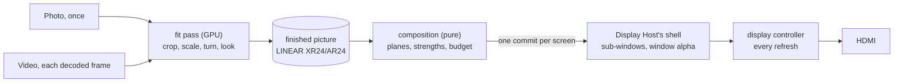

# Plane renderer

Status: built on the branch `feat/render-planes` (render redesign, [0029](decisions/0029-render-planes.md)),
2026-10-18; proven on the test Pi by the render bench ([runbook](runbook.md#the-render-bench-and-pi-testing-before-merge)).
This module implements the [Renderer boundary](module-player-execution.md) inside the single Player
process: `player/plane_renderer.py` `PlaneRenderer`, the Player's only renderer. It does not select
media, retrieve files, authenticate control messages or operate the compositor; why the Player
draws this way, what it gave up and the measured limits are [0029](decisions/0029-render-planes.md).

## The shape

Each Frame's photo or video is **finished** once by the GPU at its **finish size** (the smaller of
its source's cropped size and the Frame's placement), already turned for its screen, with the whole
look applied. The display controller (the Pi 5's HVS, the
chip that builds the screen image every refresh) then shows each finished picture as its own
**display plane** and mixes its fade by the plane's alpha. A still photo costs no GPU and no CPU
after it is finished; a fade is a change of a number, not a redraw.

| Part | Module | Owns |
|---|---|---|
| Composition | [`player/planes.py`](../player/planes.py) (pure) | which pictures are planes, stacked how, at what strength; the finish size (`finish_size`) |
| Controller budget | [`player/controller_budget.py`](../player/controller_budget.py) (pure) | what the controller can show without glitching; the cut |
| Placement | [`contracts/frame_fit.py`](../contracts/frame_fit.py) `place` | a Frame's rectangle as whole pixels on its screen as it hangs |
| The turn | [`contracts/display_turn.py`](../contracts/display_turn.py) | the four turns and their Wayland transform |
| Fit pass | [`player/fit_pass.py`](../player/fit_pass.py), [`player/look_shader.py`](../player/look_shader.py) | one draw from the source to a finished picture; the look's one GLSL copy |
| Pattern pass | [`player/pattern_pass.py`](../player/pattern_pass.py) | a test pattern, a calibration target or the commissioning grid as the screen's ground |
| GPU device | [`player/gpu.py`](../player/gpu.py) | EGL on GBM, scan-out-able targets, decoder frame imports, fences |
| Decoding | [`player/decode.py`](../player/decode.py) | a still's crop window to RGBA once, at its finish size; HEVC to the hardware decoder's frames |
| Screens | [`player/plane_screen.py`](../player/plane_screen.py) over the frame client | the Player's Wayland connection: one screen per Output, one sub-window per plane |
| Frame loop | [`player/mainloop.py`](../player/mainloop.py) `FrameLoop` | when a frame turn runs on the GLib main loop |
| Pacing | [`player/pacing.py`](../player/pacing.py) `FramePacer.free` | one commit in flight per screen |
| Wiring | [`player/renderer_root.py`](../player/renderer_root.py) | the parts built and wired; nothing else |
| Scalar reference | [`player/geometry.py`](../player/geometry.py) | every pixel rule, which the shaders are tested against |

Every rule has one home; `plane_renderer.py`'s module docstring lists the rules it owns (the drawn
Position, when a pattern shows, when a picture is finished again, the held composition, the
screen's ground, readiness, outcomes) and points at the home of every other.

## A screen

Each Output's **screen** is an xdg toplevel with app id `photo-wall-<output>`
(`player/output_discovery.py` `output_app_id`), which the shell maps full screen. Its own buffer is
the **ground**: an opaque black picture of the whole screen (the Output's mode, laid out turned
with the screen), so the controller can always scan out what the planes leave uncovered and
Weston never needs its GPU renderer for the screen's black. Planes are possible at all because the Node runs Photo Wall's Weston,
whose 64-bit plane masks give HDMI-A-1's primary plane (index 54) its own bit, which Debian's
32-bit masks shared with an overlay plane ([packaging module](module-debian-packaging.md#weston)). Above it, one synchronized sub-window
(`wl_subsurface`) per plane, up to 15 (`SCREEN_PLANES`), each with its strength set through
Wayland's standard window alpha (`wp_alpha_modifier_v1`, multiplier `round(strength x 0xffffffff)`).

- **One commit per screen** (`PlaneScreens.present`, the frame client's `pw_screen_present`):
  every plane's picture, place, buffer transform and strength reach Weston in one atomic commit,
  the screen's commit last, tagged with the Frame's witness tag and the picture change, so the
  lease, the tags and Save's evidence keep their meaning ([display host](display-host-backend.md#the-players-screens)).
  Only what changed since the last commit is sent: a sub-window is stacked once when it is made;
  its position, buffer and multiplier, and the ground, only when they differ. A restack or a
  re-sent position makes Weston repaint with its GPU (bench finding C, tracer 2).
- **A picture is reused only once released** (`wl_buffer.release`).
- **Presentation feedback rides on the topmost plane**, or on the screen when the commit has no
  plane: Weston answers feedback only for a surface it painted, and the ground under an opaque
  full-screen picture is not painted (bench finding, tracer 1).
- **The screen's facts** (`PlaneScreens.screen`): the mode and `wl_output.transform` Weston reports,
  read through `contracts/display_turn.py`, so the screen as it hangs is `hanging(mode, turn)`. The
  mode as built (`mode`, never turned) is what the Player enrolls (`output_discovery.measured`), so
  Central sizes photos and checks a rectangle against the real screen.
- **A Position trial** (`trial`) and its overlay's corners (`overlay_corners`) ride the same
  connection, sent under the very grant and tag of the present that follows.

## Composition and strengths

At each frame turn the renderer looks the held composition at the frame time (`player/look.py`
`look`), places the Frame (`place_box(box, screen as it hangs)`), and composes
the planes (`player/planes.py` `compose`): every layer `player/visibility.py` says can be seen,
bottom to top in `stack_order`.

- **The strength is the controller's encoding of the plan's alpha** (`plane_strength`). The
  controller mixes stored sRGB values, not light (bench T3). Over a picture (a cross-fade, or a
  Run playing beneath) the plane's alpha is the layer's alpha; over black (a fade through black,
  or nothing beneath) it is `encode_srgb(alpha)`, within 6 levels of 256 of the old linear-light
  mix. Which one applies is read from what the Player shows beneath (the nearest seen layer
  beneath is a media layer), never from a field Central sends.
- **A shown picture keeps its plane.** Weston hands a screen's sub-windows the controller's
  overlay planes again at every repaint, from the top down (its DRM backend,
  `drm_output_find_plane_for_view`), so a picture added on top moves every picture beneath it to
  another overlay, one that commit switches on. On the test Pi that move showed one black refresh
  at the start of every cross-fade (owner, 2026-10-19: "The cross fade is looking smoother, but it
  shows a black frame at the start of the transition"): the outgoing photo landed on a newly
  switched-on overlay, which shows nothing for its first refresh. So when a layer fades in over an
  opaque one and would itself be opaque at full (not a PNG, opacity 1), `compose` swaps the two:
  the incoming at full beneath, the outgoing on top at `1 - strength`. The controller mixes
  `a x top + (1 - a) x bottom`, so every pixel is the one the incoming at `strength` over the
  outgoing gives; the outgoing keeps its overlay, the incoming enters beneath it, covered, and at
  the end the outgoing is removed and its overlay takes the incoming's picture, as a cut does.
  Costs: a PNG, or a layer of opacity below 1, still fades in on top (no order gives the same
  mix), and a layer over one not opaque likewise; a third layer over a dissolve (a Run beneath
  plus a fade) still moves the planes below it. Moving every picture's overlay never would take a
  Weston patch that keeps each picture on the overlay it had; not done.
- **Removed, never transparent.** A plane under `MIN_STRENGTH` (1/255) is left out, never shown
  at alpha 0; a plane's blend mode is always pre-multiplied, never None (bench T3).
- **A Frame is never shown as nothing** (issue #123: "Dark on purpose (Night off, Resting) is drawn
  as a black plane by the Player so it is never mistaken for 'nothing to show'"). A Frame none of
  whose layers has a plane (an empty fallback, nothing kept and nothing playing; a moment of a dip
  too dark for any plane) gets its **dark plane**: the black picture of its placement, over the
  whole placement at full strength (`compose`; `Plane.layer` None, its picture key `#dark:<frame>`,
  which no assignment id can take). Over the screen's black ground it changes no pixel, but it is a
  picture plane, which Display Host's shell keeps the Output with ([hold](display-host-backend.md#the-hold-what-the-compositor-shows));
  the ground alone never is. It is the Player's drawing, not a layer: the presented composition
  stays the looked one, so no assignment is invented or reported presented. A test pattern, a
  calibration target or the commissioning grid is the ground and has no planes (Display's own
  drawing holds the Output), and a candidate's commit stays the bare ground (a candidate is not
  judged). Cost: the shell cannot tell this black from a Player that falls back because it can
  show none of its photos; only that run's cause faults (`app_descriptor_limit`,
  `app_unresponsive`, `app_absent`) put the card up then.
- **The cost the owner accepted** (Q2, 2026-10-17): a cross-fade is darker mid-way than a
  linear-light mix, by up to 74 levels of 256 at worst and 8-11 on average on real photos; its
  ends are identical, and a dip to black matches within 6.

## The finish size

The owner, 2026-10-18: "We don't need to apply look-and-feel at 4k resolution if the content comes in at 1080p. Plus, the final output isn't a full 4k — the frame rectangle is smaller than that. So for perfect efficiency, the look-and-feel should be applied at the minimum of the asset size and the frame size."

So a picture (a still photo or a video's frame) is finished at `player/planes.py` `finish_size`:
the Frame's placement scaled by `min(1, cropped width / placement width, cropped height /
placement height)`, each side rounded half up, where the cropped size is Central's crop window on
the prepared copy's pixels. The Frame's aspect is kept; the picture is never larger than its
placement and never larger than its source's crop. A black layer and a dark plane are the
placement's size; the ground is the screen's. Each plane carries both (`Plane.size`, its source; `Plane.at`, its
destination, the sub-window's `wp_viewport` destination), so the display controller enlarges a
smaller picture or shows it 1:1 and never shrinks one (bench T2: shrinking large sources glitches).

| Source | Frame placement | Finished at | Shown |
|---|---|---|---|
| 1080p video | 3840 x 2160 | 1920 x 1080 | enlarged |
| 6000 x 4000 photo | 1920 x 1080 | 1920 x 1080 | 1:1 |
| 1280 x 720 photo | 1920 x 1080 | 1280 x 720 | enlarged |

The look works in the picture's own coordinates and the Frame's physical size, so a picture
finished smaller looks the same, enlarged, except for what the look draws at the Frame's own
scale: the mat shadow's edge and the dither pattern are drawn at the finished resolution and
enlarged with it (two screen pixels soft for a 1080p video in a 4K Frame; far more for a small
photo). A source at least as large as its Frame loses nothing. A 1080p video
in a 4K Frame costs about a quarter of the GPU work it took at the Frame's size (35 ms per frame on
the test Pi, milestone 3).

## The controller budget

The Pi 5's controller never refuses an overload: it glitches (bench T2). So the Player never asks
for one. `player/controller_budget.py` `PI5` holds the measured limits, nowhere else: 16 planes for
both HDMI ports together, and about 15,360 source pixels crossing one output line (four full-width
4K pictures, the ground counting as one), at the controller's fixed 500 MHz, and at most four
enlarged pictures (`PI5.enlarged`: four 1080p pictures enlarged to full 4K width ran clean; each
takes line buffer memory and the kernel refused the sixth). A picture counts its placement along
the line, enlarged or not: five 1080p pictures enlarged to full width glitch as five 4K ones do. A
90 or 270 turn lays a picture's hanging height along the physical line. Two ports sharing the budget is an estimate:
the test Pi has no second screen (owner, Q6, 2026-10-18).

`PlaneRenderer.capacity` judges each composition at its busiest moment (`player/look.py`
`moments`: every set of seen layers it will take, so a fade starting between planning ticks is
counted) with `fits`. Who gives up a layer is the executor's (`player/visibility.py` `shed`,
readiness failure `capacity`), never the renderer's: `present` refuses over the budget and commits
nothing. The bench stands in for the executor with the same loop (`scripts/render_bench/timeline.py`
`shed_overload`). With one Frame per screen (owner, Q4) and at most two photos at once per Run
([the bound](execution-contract.md#a-scenes-transition-when-a-photo-starts-to-show)) the budget
bites only when Runs stack on one Frame.

## Finishing

A picture is **finished** by the fit pass (`player/fit_pass.py`): one GPU draw from the source
to a target of its finish size as it hangs, turned for the screen (`target_size`: 90 and 270
swap width and height), so Weston shows it with a matching buffer transform and never copies it
(bench T5). Per target pixel it computes `geometry.py`'s chain: `buffer_to_picture`,
`fit_source_uv` (Central's crop window, `contracts/photo_crop.py`), the decode to linear light (a
photo's sRGB, a video's BT.709), then the look (`player/look_shader.py` `LOOK_GLSL`: the paper
under the room's light and its mat shadow, the paper profile's LUT, the Display's software
settings, encode, contrast, gamma, dither), written as stored 8-bit sRGB; a picture with
transparency (a PNG) pre-multiplied. Within one level of 256 of the reference.

- **Video has the photo look** (owner, Q1, 2026-10-17): each decoded frame goes through the same
  fit pass. A video's frames come from the Pi 5's HEVC hardware decoder as SAND128 NV12 dmabufs
  (`player/decode.py`: `qtdemux ! h265parse ! v4l2slh265dec`, a ctypes pad probe adding
  `GstVideoMeta`), imported as external textures (`player/gpu.py` `import_frame`). Only HEVC: the
  media worker prepares one 1080p30 HEVC copy per video ([preparation](module-media-preparation.md)).
  A playing video has `VIDEO_TARGETS` (3) targets at its finish size: one shown, one in flight,
  one drawn, all made and imported by the `finish` that draws its first frame during its prepare
  lead, never on its first frames during the fade that reveals it (about 10 ms of CPU and an import
  each, milestone 3).
- **A still's decode holds only its window** (`player/decode.py` `StillDecode`,
  `player/planes.py` `still_region`): `filesrc ! decodebin ! videocrop ! videoconvertscale !
  RGBA appsink` cuts Central's crop window from the copy and scales it to the finish size on the
  CPU, so the texture the GPU is given is at most the finish size (at most the screen), never the
  whole copy. Central's copy of a photo is never cropped and may be longer than the Pi 5's largest
  texture (V3D's `GL_MAX_TEXTURE_SIZE` is 4,096): a 5,232 x 7,848 photo on a 3,004 x 2,140 Frame
  has a 3,004 x 4,506 copy, and the Pi draws its 3,004 x 2,140 window. Cutting in the decode
  pipeline is GStreamer's own way; uploading a region with `GL_UNPACK_SKIP_*` would still fail once
  the window itself is over 4,096 (a portrait copy on a full 4K Frame), and `jpegdec` has no scaled
  decode. At most one still decode is in flight over every Output; `finish` starts the next once it
  answers, its layer is released, its start is refused, or its layer no longer needs it (its
  picture is right again for what it is asked, or it failed; the decode is given up), and a decode
  that answers while its layer waits for a fade is taken then, so no decode nobody polls holds up
  the others. A new crop window or finish size (a new crop, a box of another shape, or a size below
  the source) decodes the still again and deletes its old texture. Costs: a Position trial that
  changes the box's shape decodes the still again (its lag is measured on the render bench), and
  the CPU scales the window (Lanczos) instead of the GPU.
- **When a picture is finished again**: a still when anything its pixels depend on changes (its
  decode, its finish size, the turn, the crop, the box's shape, the Display's picture
  operations, the Frame's lights, its LUT's generation); the turn, the picture operations, the
  lights and the LUT draw it again from the texture it has, with no new decode; a video on each
  new decoded frame while it is seen. Never for a fade.
- **When a Frame's lights are worked out**: `prepare` and `present` ask for them on every tick, and
  `player/geometry.py` `picture_lights` works them out (its peak a 33 x 33 grid in Python) only when
  what they read changes: the Frame's lighting, its room lights' entries, its physical size or the
  Display's light; otherwise its memo answers. The memo is never a source of truth: empty, it costs
  only time.
- **Finishing is off the present path.** `present`, `frame` and `prepare` never draw, upload,
  import or fence. `finish`, run after a turn's commits, does the work owed: each seen video's
  newest frame (one draw per video per call), every pattern ground and black picture, then at most
  one still step over every Output (its decode started, its decode taken, a band of `BAND_BYTES`
  of rows uploaded, or its draw) once `STEP_GAP` (one refresh) has passed. Every draw ends with an EGL fence, and a
  picture is committed only once its fence has signalled (asked, never waited for), so no GPU work
  sits between a due commit and the screen. A still that starts after a fade under way takes no
  step during it (tracer 2's finding D: finishing five 4K stills held a fade 350-417 ms).
- **Targets** (`player/gpu.py`): GBM buffers on the V3D render node, LINEAR (the controller scans
  them out unconverted; it costs the same to render as tiled, bench T5), XR24 for an opaque picture
  and AR24 for one with transparency, in ordinary memory, not CMA. A picture finished at 4K is 33 MB
  (a 1080p one 8 MB);
  a changing still holds two, a playing video three. An Output keeps black pictures of two sizes
  at most (its ground's and its Frame's); a present retires the others.
- **Memory.** A still's decoded pixels, its window at its finish size, are handed over once
  (`StillDecode.result`) and dropped once uploaded; the still keeps its source texture, at most
  its finish size (so a key change other than a new window finishes it again without a new
  decode), and its target. One still decode is in flight at a time, so the decode's own memory is
  one picture's: the whole copy before the cut, 3 bytes a pixel for a 4:4:4 JPEG (about 91 MB for
  a 4,506 x 6,759 copy, about 192 MB at preparation's 64-megapixel ceiling). There is no separate
  memory budget: what is held is bounded by the layers
  alive, which the executor's prepare lead and the controller budget bound (the old renderer's
  texture and decoder limits went with it).
- **Patterns are the ground** (`player/pattern_pass.py`): while the Display's picture operations
  carry a test pattern, or a Position trial is drawn with nothing playing (the commissioning grid),
  the commit has no planes and its ground is the pattern drawn once over the whole screen, black
  outside the Frame. A pattern is a tuning overlay: the composition reported stays the looked one.

## The frame loop and pacing

The Player's GLib main loop runs a **frame turn** (`player/mainloop.py` `FrameLoop`, at `FRAME`
priority, between control dispatch and the planning tick) after every read of the screens'
connection (a presentation, a release: a refresh went by), after a wake (a video's new frame, a
new composition) and at the time the last turn asked for (a fence to check, a fade's next frame);
never otherwise. A turn reads the connection (answering Weston's pings, which keep the shell's
lease), presents every Output's held composition again at the frame time
(`PlaneRenderer.frame`), then finishes (`finish`) and answers when it is next due (`due`).

- **Nothing changed, nothing committed.** A present commits only when the screen would show
  something else: a plane's picture, placement or strength, the ground, the tag, the picture
  change, the grant, the trial's overlay or the drawn Position. A layer's play position alone
  changes nothing. A still photo commits once and nothing after.
- **One commit in flight** (`FramePacer.free`): a commit draws nothing, so it is made as soon as
  the last one is answered (presented or discarded, or overdue by `OVERDUE`, 0.25 s, for an Output
  that says nothing). A present while the last commit is unanswered commits nothing and answers
  at once, before any sweep, grant or setting work (its answer: [Outcomes](#outcomes)). The frame
  loop and the planning tick share the one slot, so the held request is committed by the first
  present, either's, that finds the slot free; the executor waits on "pending" for at most its
  `DRAW_GRACE` (0.5 s, player/executor.py), which must exceed `OVERDUE` plus one planning tick
  (player/service.py `PLANNING_TICK_MS`, 33 ms) so a silent Output's held request is committed
  before the executor gives it up (held by `tests/test_plane_renderer.py`). `due` reads each such screen's word before
  judging its commit overdue: a turn that only asks a fence costs a read, not a present (the main
  thread was 87 % busy while a video's fence was pending, milestone 3). No steady-cadence slot: a commit aimed at one missed Weston's repaint deadline
  once and every one after it (tracer 2, finding E), so the old pacer's slot is gone.
- **Every read wakes a turn.** Any call into the screens that reads the connection outside a turn
  (the planning tick's `prepare`, `capacity` and `present` read grants and screens) may consume
  the compositor's answer the fd watch waits for, so it wakes the loop (`PlaneScreens.on_read`).
- **Every fence is asked.** `finish` ends by asking every outstanding fence (black pictures,
  pattern grounds, every layer's draw); a failed layer's draw is given up at once. While only a
  fence is pending, the next turn is `FENCE_POLL` (1 ms) away, so the planning tick and the
  decoders' callbacks run between asks. Cost: up to a millisecond between a fence signalling and
  its picture's commit. Prior art not taken yet: an EGL native fence fd
  (`EGL_ANDROID_native_fence_sync`) watched by the main loop would wake on the signal itself;
  it needs the Pi to prove Mesa V3D's support.
- **Before admission** a candidate grant gets the ground under the tag `candidate-<grant>`, again
  on every present the pacer allows (the shell completes a handoff only on a presented commit after
  its release). No grant: nothing committed, "pending".

## Outcomes

`present` answers, per Output: no grant, "pending"; an Output gone, a Position that does not lie
on the screen, a refused trial or a refused picture, "failed" (`decode`); over the controller
budget with every other Output's last commit, "failed" (`capacity`), nothing committed; a seen
layer's picture or the pattern not finished yet, "pending" (the screen keeps its last commit);
else "presented", its composition the looked one and `presented_at` the commit's time. A
"presented" answers only the request it was asked (player/rendering.py `Renderer.present`): while
the screen's last commit is unanswered, the last answer if it was made for this request
(`OutputComposition.request`: the binding, fallback, and each layer as planned with its file; the
look aside), else "pending"; a present that shows what the last commit shows answers with this
request's look. "Presented"
is the compositor's word for that commit: application evidence, not photons. Any part that
cannot be built at start (no Weston, no render node, a program that does not link) leaves the
Player registrable without a picture (`UnavailableRenderer`, fault `native_initialization`).

## Measured on the test Pi

The render bench ([runbook](runbook.md#the-render-bench-and-pi-testing-before-merge)) on the 4K test
monitor, tracer 3 and milestone 2 (2026-10-18, evidence under `/Volumes/Dock/tmp/node-render-arch/`):
every picture on its own plane, the overload step included (the ground on the primary plane);
every plane's kernel alpha equal to its strength; no glitch bit in a 400 s run; Weston's GPU idle
while pictures hold; the turned screen shown with no copy; fades at 60.0-60.4 a second with
nothing else loading the Pi. Not yet met: a photo fading into a playing 1080p30 video, and a
dissolve over one on a turned screen, ran at 56-57 a second (a refresh missed about every quarter
second). Milestone 3 traced it to the main thread (87 %: a fence poll running the whole present),
the look on each video frame drawn at the Frame's 4K size (about 35 ms, the GPU 90 % busy) and a
video's targets made during the fade; the finish size and the three fixes above address each, and
are to be measured on the Pi (the three small fixes alone gave 59.3-60 a second there). Before the redesign: about 11 fades a second at 4K, the GPU 94 %
busy.

## Tests

| Tier | What it proves |
|---|---|
| Unit (pure) | the turn and placement (`tests/test_display_turn.py`, `tests/test_frame_placement.py`), strengths, composition and the finish size (`tests/test_planes.py`), the budget (`tests/test_controller_budget.py`), the renderer through fakes of its ports (`tests/test_plane_renderer.py`), the screens' bridge (`tests/test_plane_screen.py`), the fit and pattern passes' scalar references (`tests/test_fit_pass_reference.py`, `tests/test_pattern_pass_reference.py`), `sand_modifier` and the libraries the GPU loads (`tests/test_player_gpu.py`, `tests/test_player_decode.py`), the pacer and the main loop's sources (`tests/test_player_pacing.py`, `tests/test_player_mainloop.py`), the bench's timeline and verdict (`tests/test_render_bench.py`) |
| Display harness (CI `node-pid1` `display-harness`, built packages, headless Weston) | the shell's window alpha, turn and amber (`tests/native_display_smoke.py`); the screens, planes, ground, only-what-changed, feedback under a fade burst and a picture enlarged to its placement (`tests/native_screen_harness.py`); the fit and pattern passes on software GL within one level of the reference (`tests/native_fit_pass_harness.py`); an Output document to Weston's pixels and back to the report through the whole path (`tests/native_picture_e2e_harness.py`, on `tests/harness_device.py`'s memfd device) |
| Release roots (CI `debs`) | every library `player/gpu.py` `LIBRARIES` names loads in the built app root |
| Pi only (render bench) | planes, plane alpha in the kernel, glitch bits, GBM targets, SAND128 import, the hardware decoder, the turn without a copy, fade cadence |

CI has no V3D, no HEVC decoder and no display planes: a GStreamer or Mesa update can break the
hardware path with CI green, so a change to this path is tested on the Pi before merge.
