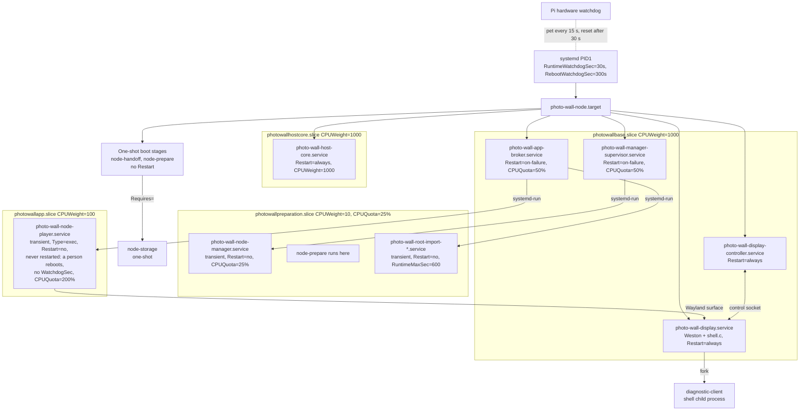
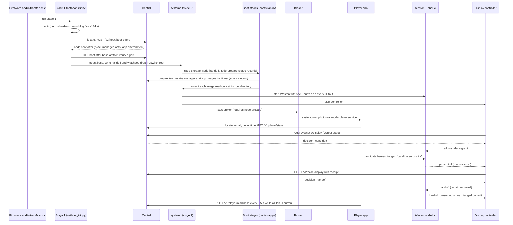
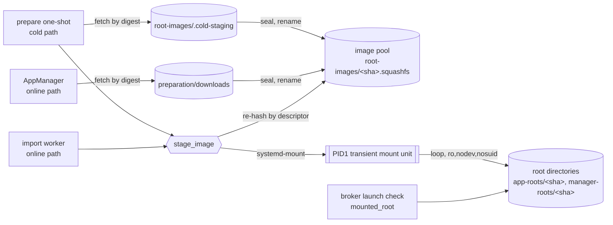
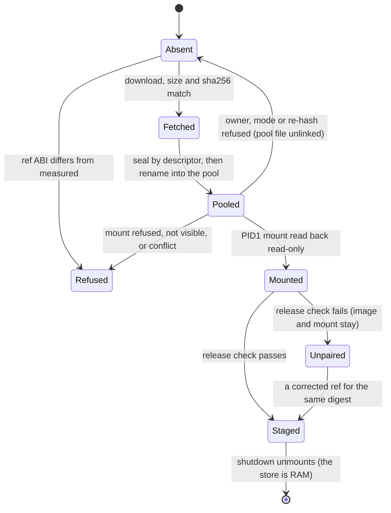
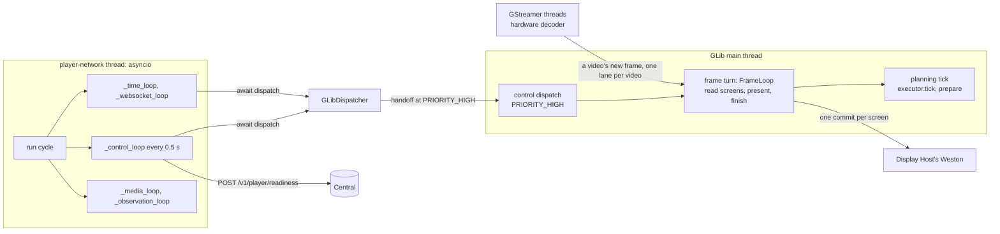
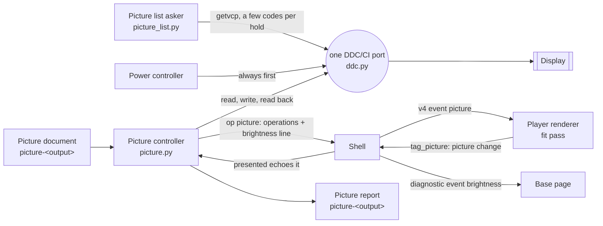

# Player node architecture (as built)

This page describes the V2 Player node as it exists at v0.17.0 (`origin/main` 860465cd). It owns the cross-layer view: which processes run on the Pi, who supervises each, what each layer guarantees, how strongly that guarantee is enforced, and what each liveness signal actually measures. It describes; it does not propose. Each policy stays in its owning document, linked from [Where to read more](#where-to-read-more). Where an owning document and the code disagree, the code is described here and the disagreement is listed under [Observed gaps](#observed-gaps).

**Superseded** wherever Central is assumed in charge: see [0016](decisions/0016-central-and-node-relationship.md) and the node redesign ([0017](decisions/0017-node-redesign-r3.md)). This page still describes the code as built; module paths name the E1 layout (`appliance/{kernel,host,boot,apps}/`). [Release roots as images](#release-roots-as-images-e2c) describes E2c as built (2026-10-09): release roots are squashfs images that PID1 mounts read-only. Roadmap delivery 1b (2026-10-10) is described where it changed the node: [display identity and power](#display-identity-and-power-1b) and the [health judge's faults](#telemetry-and-fault-channels). The render redesign ([0029](decisions/0029-render-planes.md), 2026-10-18) is described where it changed the Player: [inside the Player app](#inside-the-player-app), the [picture settings](#picture-settings-1c) it applies when it finishes each picture, and [test patterns](#test-patterns-on-the-screens-ground). The debug overlay delivery (issues #123 to #127, 2026-10-23) is described where it changed the node: [no automatic restarts](#processes-and-supervision), [the debug overlay](#the-debug-overlay) (the hold, the card and the Frame region) and the [health line](#telemetry-and-fault-channels) Central records. The Frame showing Central's error ([#145](https://github.com/mcurcio/photo-wall/pull/145), 2026-10-27) is described in [the debug overlay](#centrals-card) (Central's card) and the Player line's [`impeded` report](#telemetry-and-fault-channels).

## Overview

A Pi netboots a small initramfs (stage 1), which locates Central, takes a boot offer, mounts the offered base read-only in RAM and hands the hardware watchdog to systemd. On the base (stage 2), systemd starts the `photo-wall-node.target` cohort: three one-shot boot stages, then independent base services for host observation (HostCore), app effects (broker), manager recovery, and display policy (Weston with the Photo Wall shell plus a display controller). The broker launches the Player app from an exact, sealed app root as a transient systemd unit. The Player draws through GTK into Weston; the shell admits its surface and keeps it on screen only while tagged buffers keep being presented. Every base service and the Player report to Central separately, over separate sessions.

The base OS also runs Debian's OpenSSH server for agent access (rpi-image-gen's `openssh-server` layer; one login, by the one baked-in key only), independent of every Photo Wall unit: [Reaching a Node over SSH](runbook.md#reaching-a-node-over-ssh).

### Glossary

| Term | Meaning on this page |
|---|---|
| **Node** | One Pi booted by the node path, the only boot path: the V1 boot offer, the V1 units and the `photowall.node=v2` kernel-command-line switch are deleted ([0019](decisions/0019-debian-packaging-with-debhelper.md)). |
| **HostCore** | `photo-wall-host-core.service` ([`host_runner.py`](../appliance/host/host_runner.py)): samples host metrics, posts host observations and facts, polls and executes operator reboot commands, and owns local recovery deadlines. Never imports the Player. |
| **AppManager** | The versioned manager executable ([`manager_runner.py`](../appliance/node/manager_runner.py)) that prepares app environments in the background, run as transient `photo-wall-node-manager.service` by the base manager supervisor ([`manager_launcher.py`](../appliance/node/manager_launcher.py)). |
| **Broker** | `photo-wall-app-broker.service` ([`broker_runner.py`](../appliance/apps/broker_runner.py)), the AppEffectBroker: the only writer of the app effect journal and the only launcher and stopper of the Player process. |
| **DisplayHost** | The base display stack: Weston with the Photo Wall shell plugin ([`shell.c`](../appliance/display_host/native/shell.c), `photo-wall-display.service`) and the Python display controller ([`runner.py`](../appliance/display_host/runner.py), [`service.py`](../appliance/display_host/service.py), `photo-wall-display-controller.service`). |
| **Output** | One connected display connector, keyed by an OutputKey with connection and mode generations; each Output has its own curtain, diagnostic page and surface lease. |
| **Lease** | The shell's per-Output app-surface lease: `LEASE_MS` (5000 ms) from the last presented tagged commit or the app's last answer to Weston's ping, sent each second ([`shell.c`](../appliance/display_host/native/shell.c) `pong`, `lease_tick`; [the lease](display-host-backend.md#the-lease-presentation-or-a-ping-answer)). Expiry or process loss invalidates the surface and restores the curtain. The lease answers only "is the app alive"; it is never the hold. |
| **Hold** | Whether a handed-off Output stays the app's: asked by the shell every 200 ms on the compositor's own scene, never on the app's word. Evidence is a picture plane of the app's that is mapped, has a buffer and a window alpha above 0, or Display's own drawing (a test pattern, calibration target or live trial). Without it the holding slate covers the app, grant kept ([the debug overlay](#the-debug-overlay)). |
| **Debug overlay** | The owner's term (2026-10-20) for the one overlay that shows when something is wrong: the holding slate and the health judge's card, both drawn by Display Host's private client inside the Frame region, or on the whole Display when that region cannot be met, and since 2026-10-27 Central's card when no Pi card shows ([the debug overlay](#the-debug-overlay)). In code: the diagnostic surface, `overlay/`, the health layer. |
| **Player app** | The Player process ([`player/service.py`](../player/service.py)) from the sealed app root, run as transient `photo-wall-node-player.service`. Immich-unaware; talks to Central over `/v1/player/*`. |
| **Readiness** | The Player's `POST /v1/player/readiness` report, sent from its control loop at most every `REPORT_INTERVAL` (0.5 s, [`contracts/liveness.py:19`](../contracts/liveness.py)) and only while the Player has an executor and a current Plan ([`service.py:890-892`](../player/service.py), `:1114`). Central's last accepted readiness report is the Player's only liveness record. |

## Processes and supervision

Facts behind the diagram:

- **Hardware watchdog.** Stage 1 arms `/dev/watchdog0` first, at `STAGE1_WATCHDOG_TIMEOUT` = 124 s ([`appliance/bootstrap.py:356`](../appliance/bootstrap.py), armed at [`netboot_init.py:760`](../appliance/netboot_init.py)), pets it on every phase line and base block, and finally writes `/run/systemd/system.conf.d/90-photo-wall-watchdog.conf` with `RuntimeWatchdogSec=30s` and `RebootWatchdogSec=300s` ([`bootstrap.py:358-360`](../appliance/bootstrap.py), `:472-475`). From then on PID1 pets the hardware. The full boot-segment table (EEPROM, kernel, initramfs, stage 1, stage 2) is in the [execution contract](execution-contract.md#netboot-stage-1-boot-data-the-clock-record-and-liveness).
- **Units.** All unit files are in [`appliance/systemd/`](../appliance/systemd/). They ship in the `photo-wall-node` package, which enables `photo-wall-node.target` with a link it ships as data (`debian/photo-wall-node.links`); the package's build check holds every unit's `ExecStart` to an installed launcher directory or binary ([Debian packaging module](module-debian-packaging.md)). The V1 units (`photo-wall-provision`, `photo-wall-player`, `photo-wall-os-agent`, `photo-wall-weston`) are deleted, not disabled.
- **Restart policies.** HostCore `Restart=always`, `RestartSec=2`, no start limit set. Broker and manager supervisor `Restart=on-failure`, `RestartSec=2`, `StartLimitBurst=10` per 10 min. Weston and the display controller `Restart=always`, `RestartSec=2`, `StartLimitBurst=10` per 10 min. No node unit sets `WatchdogSec=` or `Type=notify`; the V1 `player.service` and its `WatchdogSec=300` are deleted.
- **The Player unit** is started by the broker with `systemd-run --quiet --collect --unit=photo-wall-node-player.service --service-type=exec` ([`process_linux.py:318`](../appliance/apps/process_linux.py)) and the properties of `app_unit_properties` ([`process_linux.py:72-98`](../appliance/apps/process_linux.py)): `Slice=photowallapp.slice`, `MemoryMax=2G`, `TasksMax=128`, `CPUQuota=200%`, `RuntimeMaxSec=infinity`, `Restart=no`, `KillMode=control-group`, `TimeoutStopSec=30`, a sealed `RootDirectory`, `PrivateDevices=yes` with only the GPU render node and the HEVC decoder granted ([`device_grants.py`](../appliance/apps/device_grants.py), [domain model](player-node-domain-model.md)), `StopPropagatedFrom=` and `After=` the display unit (it stops with its Weston incarnation and no job on the display unit ever starts it; [display host](display-host-backend.md)), and no `WatchdogSec`. The unit also sets `PYTHONFAULTHANDLER=1`, so a Python crash leaves its traceback in the journal. The broker's `reconcile` records an exited Player as `phase="down"` (fault `process_exited`) when it exited under its own Weston, and reports it. A running Player of the launch's root, cgroup and environment that the broker did not start is adopted as a new launch; a unit under the Player's name that is not the launch's is stopped and nothing starts in its place; any other observation fault is reported on the broker's node feed (`app_observation_failed`) and observed again on a backoff (`OBSERVATION_BACKOFF_MS`), never an exit of the broker (incident 2026-10-13: `BindsTo=` let a signal range change's Weston restart start the Player, and the broker crashed on the run it never launched until its start limit left it failed).
- **No automatic restarts (issue #125).** Owner, 2026-10-20: "a human. dont do automated reboots yet. i want to see every time it fails for now"; asked whether that covers the Player program alone: "No auto-restarts at all". This reverses 1b's paced restart and [0015](decisions/0015-player-base-layer-and-health-overlay.md)'s R8 ("restarts never give up"). Exactly three causes start a Player run ([`broker.py`](../appliance/apps/broker.py) `StartCause`), and nothing else does:
  - `cold_start`: once per boot, from the boot offer (`AppEffectBroker.cold_start`).
  - `display_restarted_on_purpose`: Display restarted Weston itself (a signal range change) under a live run, which took the run with it. One rule, `start_for_display` over the pure `restarted_on_purpose`, serves whichever launch is current: the run starts again only when the Weston up now differs from the one it was launched under, Display's mark (`/run/photo-wall-display-restart/restarted`, written by `photo-wall-display-signal.service` before its restart, `appliance/kernel/display_paths.py` `PURPOSEFUL_RESTART`) names that launch's Weston, and the run was not first seen absent under its own Weston (`exited_under`).
  - `release_switch`: a person applies a release, and the target starts once (`online_broker.py`). A target that fails to start, or exits before it proves control, is `target_failed`, then `effect_unknown` with fault `target_failed`: never a fallback to the old release and never a second try.

  A run that exits, freezes, runs out of open files, or dies while its Weston lives stays down for the rest of the boot: the broker records it `down` (fault `process_exited`), a crashed Weston starts nothing either, and a foreign unit under the Player's name is stopped with nothing in its place. The kill path is gone too (`KILL_AFTER_MS`, the kill-due latch, the feed facts `probe_kill_due`, `app_killed` and `kill_withheld`): nothing kills a Player that stops answering. The debug overlay's card names the cause and the time on the Pi's clock ([the debug overlay](#the-debug-overlay)), Central records it ([health line](#telemetry-and-fault-channels)), and a person recovers with **Hardware › Reboot** ([runbook](runbook.md#a-dark-frame-read-the-card-then-reboot)). `Restart=` stays `no` and no dependency lets a job on another unit start the app (`process_linux.app_unit_properties`): either would start runs the broker never journaled. HostCore's local recovery deadlines no longer reboot: a missed stop or restore deadline moves the row to `deadline_missed` (diagnostic `stop_deadline` or `restore_deadline`, fault `local_recovery_` plus it) and nothing else ([`recovery.py`](../appliance/node/recovery.py)). Base units keep their own systemd restarts (above), and the hardware watchdog stays (owner: "keep"); HostCore reports `reset_cause` in its host facts, and the Hardware page shows "Last start: after a hardware watchdog reset" when it reads `watchdog`. The Pi 5's watchdog driver cannot report one (its `options` lack `WDIOF_CARDRESET`), so on today's Pis `reset_cause` is None and the line never shows (`.claude/errata.md`, overlay-always S5).
- **The root-import worker** is a transient `photo-wall-root-import-<operation>.service` the broker starts during an online switch, in `photowallpreparation.slice` with `CPUQuota=25%`, `Restart=no`, `RuntimeMaxSec=600`, one read-write bind over the whole node store and `CapabilityBoundingSet=CAP_DAC_OVERRIDE CAP_CHOWN`, so it can seal AppManager's download and rename it into the image pool ([`import_worker.py`](../appliance/apps/import_worker.py) `advance`; [Release roots as images](#release-roots-as-images-e2c)).
- **The diagnostic client** is forked by the shell inside Weston's service (`/usr/lib/photo-wall/node-display/diagnostic-client`, [`shell.c:839-850`](../appliance/display_host/native/shell.c)); the shell reaps it on its 200 ms timer (`:858-859`).
- **The node-storage stage** is not in the target's `Wants=`; `photo-wall-node-prepare.service` pulls it in with `Requires=`.
- **The manager unit** is started the same way with `CPUQuota=25%`, `Restart=no` ([`manager_launcher.py:58-75`](../appliance/node/manager_launcher.py)). Its supervisor polls every 2 s and spends a boot-scoped attempt budget across the pinned primary and fallback roots ([player node domain model](player-node-domain-model.md#recovery-of-appmanager-itself)).
- **Memory limits** depend on the cgroup memory controller, whose absence is reported, not refused ([player node domain model](player-node-domain-model.md#memory-classes-and-the-node-store-2026-10-03)).

## Boot to pixels

- **Stage 1.** [`appliance/netboot_init.py`](../appliance/netboot_init.py) (module docstring, phases 0–7) with the trust and locate client in [`uplink/`](../uplink/). The boot offer is `POST /v2/node/boot-offers` (`netboot_init.py:667`), the base is `/v2/node/boot-offers/{id}/artifacts/base` (`:690`), and the handoff is written at `:724`. Every failure prints one `FAILED phase=<n>` console line and exits into `photowall_restart` ([`photowall-netboot:41`](../appliance/netboot_initramfs/scripts/photowall-netboot)).
- **Boot stages.** [`appliance/boot/node_bootstrap.py`](../appliance/boot/node_bootstrap.py) runs `storage`, `handoff` (`materialize_handoff`, which writes the per-owner configurations into `/run/photo-wall-node/`) and `prepare` (`prepare_roots`, inside `DOWNLOAD_WINDOW_SECONDS` = 900 of the unit's `TimeoutStartSec=1200`). Each stage records `running`, `done`, `refused` or `failed` in `/run/photo-wall-boot-stage/` ([`boot_stage.py`](../appliance/kernel/boot_stage.py)); HostCore is the only reader. The download and retry rules are in [`preparer.py`](../appliance/node/preparer.py) and the [Player node domain model](player-node-domain-model.md#memory-classes-and-the-node-store-2026-10-03); `prepare_roots` stages each fetched image as [below](#release-roots-as-images-e2c).
- **Display handoff.** Central issues `candidate`, `handoff`, `withdraw` and `revision` decisions as responses to the controller's `POST /v2/node/display` ([`service.py:138-196`](../appliance/display_host/service.py)). The shell accepts a handoff only with a buffer presented within the last `LEASE_MS` and an unexpired lease ([`shell.c:715-731`](../appliance/display_host/native/shell.c)), and reports `handoff_presented` only on a later presented commit (`:529-533`). Policy: [display host backend](display-host-backend.md#authority-and-presentation-evidence).

## Release roots as images (E2c)

Each release root (the app environment and the manager root) ships as one reproducible squashfs image whose sha256 is the release's `environment_sha256`. The Node fetches the image by digest, checks it, and asks PID1 to mount it read-only at the path where the unpacked root used to sit. Nothing is unpacked and nothing is copied, so the Node holds each root's bytes once (app about 288 MiB, manager about 62 MiB). Every launcher keeps `RootDirectory=<root directory>/<sha>/rootfs`.

| Term | As built |
|---|---|
| **Image pool** | `/run/photo-wall-node-storage/root-images/` (`capacity.ROOT_IMAGES`), root-owned 0755, created by the storage stage. Each image is `<sha>.squashfs`, root:root 0444, one link. HostCore's unit makes it inaccessible, as it does the root directories. |
| **Root directories** | `app-roots/` and `manager-roots/` on the store: one mount point per staged root, created by PID1 when it mounts. |
| **Mount unit** | A transient `.mount` unit that `systemd-mount --collect` asks PID1 for, loop-backed, options `ro,nodev,nosuid` ([`image_mount.py`](../appliance/kernel/image_mount.py) `SystemdImageMounter`). The mount lives in the host namespace. A second request for a mounted path reads the existing mount instead of asking again. A mount of another image, another type, or a writable one at that path is `image_mount_conflict` and is never unmounted. Nothing on the Node unmounts a root: the store is RAM, and shutdown unmounts it. |
| **Read-only** | The mountinfo per-mount options (field 6) contain `ro` **and** the loop device's `/sys/dev/block/<maj:min>/ro` is `1`. `findmnt` OPTIONS are not enough: a squashfs superblock is always `ro`, even under a writable mount. |
| **Release check** | `verify_release` ([`environment.py`](../appliance/apps/environment.py)): what the image digest does not prove. The manifest's `reference` matches the ref, the ref's base, graphics and plugin ABI equal the Node's **measured** ABI, the two provenance files hash to the ref's values, and the entry point and `usr/bin/python3` resolve to executable files through the manifest. It reads three small files, not the tree. |
| **Staged** | `mounted_root`: the mount at `<root directory>/<sha>` is a read-only squashfs backed by the sealed pool file `<sha>.squashfs` of the ref's size, **and** the release check passes. It is recomputed at every use and never recorded. A directory's existence never counts, because an empty mount point survives an unmount. |

**One staging function.** `stage_image` is the only code that writes the image pool or asks for a mount. The cold path (`prepare_roots` in [`node_bootstrap.py`](../appliance/boot/node_bootstrap.py)) and the online path ([`root_import.py`](../appliance/apps/root_import.py), inside the import worker) call it with the same arguments, the measured ABI included. The broker hands the import worker its own measured ABI in the import request. In order, it:

1. refuses a ref whose ABI differs from the measured one (`environment_abi_mismatch`), before any I/O;
2. returns at once when the root is already staged, unlinking a duplicate incoming file;
3. **seals** the incoming file by descriptor (`fchown` to root, `fchmod` 0444) and only then **adopts** it into the pool with one `os.rename`, never a copy (`root_image_adopt_cross_device` if the rename would cross mounts). An incoming file whose digest the pool already holds is unlinked;
4. re-hashes the pool file by descriptor; a pool file that fails this check or its owner, mode or link checks is unlinked (`root_image_digest_mismatch`, `root_image_ownership`), so the next attempt starts clean;
5. asks PID1 for the mount and reads it back in its own namespace (`image_mount_failed`, `image_mount_not_visible`, `image_mount_conflict`);
6. runs the release check. Its refusal leaves the image and the mount in place, and a corrected ref for the same digest then stages without a download.

A stager killed at any point leaves nothing a launch accepts: a file gets a pool name only after it is sealed, a mount is asked for only after the re-hash passed, and the release check runs at every use. A file killed between seal and rename is adopted by the next `stage_image`.

**The launch check.** Before `systemd-run`, the broker's `SystemdAppProcessDriver.verify` ([`process_linux.py`](../appliance/apps/process_linux.py)) calls `mounted_root` with the measured ABI and refuses `root_image_not_staged` or the release check's refusal. It does not walk the tree. Per-file verification of a release (`verify_root`, every file re-hashed against the manifest) runs at build time, over the mounted shipped image in node-components' image test, and in the retiring AppManager's launch of its own root. The Node trusts the release digest for the tree.

**Three sandboxes see PID1's mounts.** The prepare one-shot and the import worker read their own mounts back; the broker, whose namespace exists before any online target is mounted, sees each later mount through systemd's slave propagation from the shared host `/run`. The cold mounts exist before the broker starts (`photo-wall-node-prepare.service` is `Before=` the broker).

**Online targets.** AppManager downloads a target into `preparation/downloads/<sha>` and skips one whose image the pool already holds (`pooled`, through a read-only bind of the pool), so a rollback or a retry within one boot downloads nothing. The import worker then stages it into the pool by rename across its one store bind. Superseded images stay until reboot; eviction belongs to the Content epic ([0017](decisions/0017-node-redesign-r3.md) C10).

**Build side.** `debian-packaging/build-root.sh` builds each root's image twice on a cache miss and refuses unequal digests, and `scripts/node_release_writer.py` refuses an image larger than its memory line (`appliance/kernel/capacity.py`). The root is resolved by `mmdebstrap` from the Debian snapshot pin and the run's local repo, sealed by `debian-packaging/seal-hook.sh` and `scripts/seal_root.py`, and written as a squashfs image; no tar is an intermediate ([Debian packaging module](module-debian-packaging.md#build-steps)). The memory lines the images and the preparation slice fit are in the [Player node domain model](player-node-domain-model.md#memory-classes-and-the-node-store-2026-10-03); reading them on a Node is in the [runbook](runbook.md#node-storage-release-images-and-memory-lines).

## Inside the Player app

Since the render redesign ([0029](decisions/0029-render-planes.md)) the Player has no GTK: its main
loop is a plain GLib loop, its only Wayland client is its screens' connection
([`player/plane_screen.py`](../player/plane_screen.py)), and each Frame's picture is a display
plane ([plane renderer](module-plane-renderer.md)).

- **Main thread.** `main()` builds the `GLib.MainLoop`, the renderer (`player/renderer_root.py` `start_renderer`), the planning tick and the network thread. Every GLib source goes through [`player/mainloop.py`](../player/mainloop.py), in the order CONTROL above FRAME above TICK: thread-to-main handoffs first, then the screens' frame turns, then the planning tick, which re-arms only after its work with a gap. The tick plans what each Frame shows (`executor.prepare_imminent()`, `executor.tick()`, which present compositions); a picture that changes over time (a fade, a video, a finished picture, a trial's edit) reaches the screen through the frame turns (`FrameLoop`), never at the tick's pace. A frame turn runs after a read of the screens' connection, a wake or the time the last turn asked for, and never otherwise; a still photo is committed once and costs nothing after.
- **Network thread.** `start()` runs `asyncio.run(self.run())` on the non-daemon `player-network` thread. Each run cycle locates, enrolls, says hello, probes time, polls state, then runs the control, time, media, observation and WebSocket loops until one ends. The control, time and WebSocket loops await main-thread dispatches; the media and observation loops do not.
- **Hand-off.** Everything that touches renderer or control state crosses to the main thread through `GLibDispatcher`: a bounded semaphore (a call past its slots fails at once with `dispatch_capacity`), each accepted call one idle at `PRIORITY_HIGH`, above the frame turns and the tick. A video's decoder callback only records its newest frame and posts through its own lane (two slots per video, so one video's flood never drops another's), then wakes a frame turn.
- **Control loop.** `_control_loop` awaits `poll_state`, then `dispatch(self._feedback)`, posts readiness when the executor and a current Plan produced one, queues observations and sleeps out the 0.5 s interval. The Player sends no `sd_notify` messages (its watchdog pets and health file were deleted in PR 45).

Threading and execution policy is owned by the [Player service module](module-player-service.md#control-media-and-authority) and the [plane renderer](module-plane-renderer.md).

## Layers and guarantees

Read bottom to top. "Enforcement" names the strongest mechanism that actually holds the guarantee on the node today: **hardware** (the SoC watchdog resets the Pi), **supervisor** (systemd restarts or a supervisor process acts), **construction** (the code path cannot do otherwise), **test** (an automated test asserts it), **documented-only** (stated in a design document, nothing on the node enforces it).

| Layer | Process / unit | Supervisor | Guarantee (owning doc) | Enforcement | What its liveness signal measures | Reports to Central |
|---|---|---|---|---|---|---|
| Boot stage 1 | initramfs `netboot_init.py` | Hardware watchdog, 124 s, pets refused after `STAGE1_BUDGET` 600 s | "A failed or hung boot must always come back" ([execution contract](execution-contract.md#netboot-stage-1-boot-data-the-clock-record-and-liveness)) | Hardware; tests [`test_netboot_liveness.py`](../tests/test_netboot_liveness.py), [`test_boot_script.py`](../tests/test_boot_script.py) | Phase progress: each console line, base block and network call pets | Boot offer request only; failures are console lines |
| systemd PID1 | PID1 | Hardware watchdog via `RuntimeWatchdogSec=30s` | Stage 2 reboots if PID1 stops petting ([execution contract](execution-contract.md#netboot-stage-1-boot-data-the-clock-record-and-liveness)) | Hardware | PID1's own event loop only; says nothing about any service | Nothing directly |
| Boot stages | `photo-wall-node-storage`, `-handoff`, `-prepare` (one-shot) | PID1, no restart; `TimeoutStartSec` 15 s (storage), 1200 s (prepare) | Stage outcome is recorded and never altered by a failed record write ([`boot_stage.py`](../appliance/kernel/boot_stage.py) docstring; [4 GB design](node-4gb-memory-design.md)) | Construction + test | Stage file state (`running`/`done`/`refused`/`failed`) | Via HostCore facts (`boot`) and PID1's failed-unit list |
| HostCore | `photo-wall-host-core.service`, `photowallhostcore.slice` | PID1 `Restart=always` | Breaking the app "cannot prevent its independently supervised host report or authenticated reboot path" ([domain model](player-node-domain-model.md#promise-failure-envelope-and-selected-choices)) | Supervisor + construction (separate slice, `CPUWeight=1000`, `MemoryMin`, `OOMScoreAdjust=-900`); no Player, broker or manager import, refused at package build by the import check (`scripts/import_check.py`; host-core's launcher path lists only host-core's allowed layers) | Its own loop reached `tick` and Central stored a sample; a host heartbeat "is never proof of output pixels" (same section) | Host observation every 15 s, host facts on change, reboot evidence |
| AppManager + broker | `photo-wall-manager-supervisor`, transient `photo-wall-node-manager`; `photo-wall-app-broker` | PID1 `Restart=on-failure` (supervisor, broker); supervisor's attempt budget (manager) | "Prepare cannot stop, hide, or invalidate the healthy app" ([implementation map](player-fleet-implementation-map.md#bounded-contexts-and-transaction-ownership)); broker is sole app launcher ([domain model](player-node-domain-model.md#layer-goals-and-fact-ownership)) | Construction (separate units, slices, credentials) + test (`node_pid1` scenarios) | Manager: supervisor summary (`manager_running`, `manager_attempts`, age) sampled by HostCore. Broker: none of its own | Broker: app process evidence (`running`/`exited`), effect events. Manager: its own `app_manager` session polls `GET /v2/node/app-desired` and posts preparation observations |
| Weston + shell.c | `photo-wall-display.service` | PID1 `Restart=always`, 10 starts per 10 min; `Type=notify` with a 10 s watchdog ([units](display-host-backend.md#units-and-weston-incarnations)) | Process exit, lease expiry, host restart or Output change "restores the base diagnostic" ([domain model](player-node-domain-model.md#display-and-calibration), [display host backend](display-host-backend.md#authority-and-presentation-evidence)); a handed-off Output with no hold evidence gets the holding slate ([the debug overlay](#the-debug-overlay)); with the overlay client dead the amber covers the whole Output | Construction (in-compositor 200 ms timer, [`shell.c`](../appliance/display_host/native/shell.c) `lease_tick`, `hold_sync`, `fallback_sync`; `abort()` on curtain failure) + test (`tests/native_display_smoke.py`, `tests/native_screen_harness.py`) | Lease: a presented commit or a ping answer from the admitted process in the last 5 s, and the process start time still matches. Hold, apart: a picture plane the compositor shows, or Display's drawing | Through the controller; the `hold` event reaches the health judge through Display's feed |
| DisplayHost controller | `photo-wall-display-controller.service` | PID1 `Restart=always`, 10 starts per 10 min; `BindsTo=` Weston: one controller per Weston incarnation ([units](display-host-backend.md#units-and-weston-incarnations)) | Presentation evidence comes only from compositor `presented` feedback ([display host backend](display-host-backend.md#authority-and-presentation-evidence)). Display power (1b): each Output is worked toward its Output document; it reads before it writes and never retries in a loop ([display power](#display-identity-and-power-1b)). Picture (1c): a setting acts where the document says, a refused write is reported and never moved, the newest document wins ([picture settings](#picture-settings-1c)) | Construction | None of its own; its network worker failure raises in `tick` and the unit restarts ([`service.py:107-109`](../appliance/display_host/service.py)) | `POST /v2/node/display` every 3 s stable, 1 s transitional, 250 ms during trials; surface facts as evidence snapshots |
| Player app | transient `photo-wall-node-player.service`, `photowallapp.slice` | Broker launches it and never restarts it ([no automatic restarts](#processes-and-supervision)); PID1 `Restart=no`; no watchdog, so a hung or dead Player stays down under the debug overlay's card until a person reboots | "No host identity/health, package or reboot authority" ([domain model](player-node-domain-model.md#layer-goals-and-fact-ownership)); readiness at least twice per second while a Plan is active ([Player service](module-player-service.md#control-media-and-authority)) | Construction (sandbox properties, slice limits). Liveness: documented-only on a node | Readiness: the asyncio thread completed `poll_state` plus two main-thread dispatches and Central accepted the POST | Readiness, observations, control acks, base health |
| Central | readiness and silence classification | n/a | A Player reads silent `SILENT_AFTER_SECONDS` (31.5 s) after its last accepted report ([`contracts/liveness.py:28`](../contracts/liveness.py)); a host after `HOST_SILENT_AFTER_SECONDS` = 4 × 15 s ([`host_thresholds.py:15`](../central/fleet/host_thresholds.py)) | Construction (one constant served to the console) | Age of the last accepted report on Central's clock; [`readiness_diagnostics.py:100`](../central/readiness_diagnostics.py) drops silent Players from diagnostics | Console states `player-silent` (alarm, [`health.js`](../central/console/src/health.js)) and host silence ([`hostHealth.js`](../central/console/src/hostHealth.js)); host temperature bands notice 75 °C, alarm 80 °C, CPU unbanded ([`host_thresholds.py:19-26`](../central/fleet/host_thresholds.py)) |

## The debug overlay

Owner, 2026-10-20: "the debug overlay can always render when it needs to"; "A crash in the Player shouldnt have any effect on the ability to see/detect/recover from it"; "a singular special overlay on the Frames/Display that shows up when errors occur, or when Central overrides it on". The debug overlay is that one thing: the **holding slate** (the shell's curtain with the private client's page, which names why the app does not hold the Output) and the **card** (the health judge's tint with two lines), both drawn by Display Host's private client (`overlay/`), never by the Player. Central's on-switch (issue #128) is not built; the overlay's input is shaped so it adds a trigger, not a layout.

**When it shows.** Three questions, each answered once:

- **Liveness** (is the app alive): the shell's lease, 5 s from a presented commit or a ping answer ([glossary](#glossary)). Losing it invalidates the Output (reason `surface_lease_or_process_lost`, "Player stopped - recover with Hardware > Reboot") and the slate returns. Central may offer the same frozen run again (no candidate, none admitted); the shell takes the offer, so a run that resumes can hand off, but its slate keeps that reason rather than "Starting Player" until that run hands off or another run is offered ([`shell.c`](../appliance/display_host/native/shell.c) `lost_pid`).
- **Hold** (does the app show something on this Output; issue #123): asked by the shell every 200 ms on the compositor's own scene (`shell.c` `hold_evidence`). Evidence is a picture plane of the app's (a sub-window that is mapped, has a buffer and a window alpha above 0: authored black is a black layer's plane, and a Frame with nothing kept and nothing playing is the Player's dark plane, its black picture over the Frame, [plane renderer](module-plane-renderer.md#composition-and-strengths), so both hold) or Display's own drawing (the `picture` op's `drawing`, true exactly while the picture document carries a test pattern or calibration target, or a live trial). The app's ground and its frame tag are never evidence. A handed-off Output without evidence gets the slate (reason `hold_lost`, "Waiting for a picture"), grant and identity kept, and loses it when evidence returns; each change is a `hold` event ([display host](display-host-backend.md#the-hold-what-the-compositor-shows)). A candidate is not judged: its empty commits still bring the handoff. So a Player that answers pings but commits no plane loses the screen, while Night off, Resting (the display powered off; Display's black picture), authored black, nothing to play, patterns, calibration targets and trials do not. The cost: a Player that falls back because it can show none of its photos draws its dark plane too, which the shell cannot tell from black on purpose; only that run's cause faults put the card up then (2026-10-20, out of open files for 10 hours: `app_descriptor_limit`).
- **Faults** (what is wrong): the health judge's catalogue ([below](#telemetry-and-fault-channels)). Each connected Output's card is the first display-affecting raised code in `CARD_PRECEDENCE` (`app_absent`, `app_unresponsive`, `app_descriptor_limit`, `nothing_to_show`, then any other by name; [`judge.py`](../appliance/health/judge.py)). Line 1 is the code's household line and the time its evidence began on the Pi's own clock in its local zone ("Photos paused — the player stopped · since 08:10"); line 2 is `"{code} · Player {id} · Output {output}"`. A run cause (`app_absent`, `app_unresponsive`, `app_descriptor_limit`) stays on the card until another run starts, which only a person's reboot or release brings ([no automatic restarts](#processes-and-supervision)).

**Where it shows** (issue #124). Owner, 2026-10-20: "make sure that the debug overlay shows within the configured Frame regions when available, and only falls back to the Display when the Frames are not configured or cannot be met". Central sends each Output its bound Frame's rectangle in whole pixels on the screen as it hangs, on its own document (`region-<port>`, beside `picture-<port>`, with its own change number; [`contracts/node_output.py`](../contracts/node_output.py) `FrameRegionDocument`, worked out by `central/displays/model.py` `frame_region` from the Position). Display Host computes no Frame geometry ([0030](decisions/0030-frame-box.md)): the controller forwards the region to the shell (`region` op), the shell forwards it verbatim to the private client (diagnostic manager v5 `region` event), and one rule places the overlay ([`overlay/area.py`](../appliance/display_host/overlay/area.py) `explain_area`): the Frame region when it can be met, else the whole Output with the reason (`no_region`: none sent, no Frame bound, no screen known or the document refused; `screen_differs`: the screen now is not the one Central placed on; `too_small`: under 448 x 252, the slate's smallest page). Outside the area the slate and a tinted card are opaque black. The Output report now carries the mode Weston runs (`current_mode`), which `screen_px` prefers, so the region is placed on the screen the Pi actually drives.

**When it cannot show.** With the private client dead, the shell's amber covers the whole Output, handed off or not (`fallback_sync`), so a crashed overlay client never leaves a Frame looking healthy.

### Central's card

Owner, 2026-10-27: "the error in this case is Centrals, not the Player. The Player is being told to go dark and it doesn't know that the reason is bogus"; asked when Central's errors impede the Frame, which Frames get a card and whether Home Assistant's link closing counts: "1&2&3 all have the same answer: when the issue induces blackness on the frame". So the debug overlay has two cards and one rule: **the Pi's card wins.** The overlay client draws the health judge's card (or the slate) when one shows, else Central's card, else nothing ([0015](decisions/0015-player-base-layer-and-health-overlay.md), [0028](decisions/0028-room-light.md#centrals-doubt-travels-2026-10-27)).

- **Central marks.** When Central can't stand behind a room light's brightness (its source can't tell, Central can't read the source's report, or the source's link to Central's hub closed), the room-lights document carries Central's two lines on that light's entry (`contracts/room_light.py` `CentralWords`, each at most 96 characters, dated in the house's zone). The Player draws exactly what the document says: the last stated value stands, so a light last said "off" stays off. No fallback picture, no Player lighting rule.
- **The Player judges** ([`player/impediment.py`](../player/impediment.py)): a Frame is **impeded** when the light it drew at the Frame's centre is exactly 0 lx (black) and at least one light the Frame's lighting names carries Central's words. A dim but non-black Frame is never impeded; its doubts still show on Needs attention and House › Lights. Every main-loop turn the Player judges every Frame it draws and puts the result whole on its line's `impeded` key ([`contracts/node_impeded.py`](../contracts/node_impeded.py) `ImpededFrames`, restated at every attach), each entry naming the shell grant the Frame was drawn under.
- **Display Host's controller composes** ([`central_card.py`](../appliance/display_host/central_card.py) `central_card`), per Output: powered off (Night off, Resting), Display's own drawing (a test pattern, calibration target or trial) or no run admitted (the slate) give no card; a report entry naming this Output's admitted Frame **under the admitted grant** gives Central's card, Central's words verbatim; anything else (not reported yet, a value it cannot decode, another grant) gives none. It reads the report through Display's own reader of the Player line on the Pi's bus (`bus.py` `BusImpededReports`, `nodeapi.node` `StateReader`), never the Player's process or screen connection. The grant is identity, not time: a crashed or hung run's admission ends (at the latest when its 5 s lease lapses), so its report never keeps the card up, and a new run must restate it.
- **The shell carries** it as one message, `central_card` (diagnostic manager v6, beside `region`), stored per Output, forwarded verbatim after every configure and dropped with the grant on invalidate. It carries Central's words, never a verdict or a code.
- **The overlay client draws** it ([`overlay/render.py`](../appliance/display_host/overlay/render.py) `render_central`) inside the Frame's explain area: a light card labelled "Central" in Central's blue, then Central's two lines, with no tint, no slate and no amber, and nothing drawn outside the card, so the Frame's own picture shows around it. Line 1 says what is wrong and since when ("Photo Wall can't read Family Room Lights · since 29 Oct 18:05"; "… its light can't tell · since …"; "Photo Wall lost the link to … · since …"), line 2 the last word the Frame is drawn with ("Its last word: off (26 Oct 15:35) · see Needs attention in Photo Wall").
- **The health judge never sees it.** It never receives the report or the card (import-linter "Health never reads the Player's impeded report"): Central's error is never on the health line, never "Dark since …", never under Hardware. Central records the report like every Player line key, and the Frame page's Overview shows it as **Central's error** ([runbook](runbook.md#centrals-error-on-a-frame)).

What the Frame shows, case by case: a Pi fault or the slate wins and Central's card returns when it ends; a test pattern, target or trial shows alone; an Output off shows nothing; with Central or its hub away the Pi keeps its last document and its doubts, so the card stays (Central being away is not itself a card); an ended Player run shows the Pi's `app_absent` card; a hung Player keeps Central's card as last reported until the Pi's card is raised and wins. A bus restart under a Player that kept running keeps the last report read until the Player restates at its attach (the nodeapi reader keeps its last good value; a Player that restarted is a new run with a new grant, so its old report counts for nothing). Central's card also shows before the health judge's first instruction; the judge's stale page (no instruction within V) is a Pi card and wins. A Pi on an older release drops the new document, shows "Behind" on Lighting and draws no card. The real compositor's pixels of Central's card on a real HDMI Output are a bench step: the display harness's Output is headless, so CI proves the shell's op and the card's ink inside the area, not a real port.

## Display identity and power (1b)

The display controller is the first Node program that takes instructions from Central over the [Node bus](runbook.md#the-node-bus-and-centrals-hub). It runs the `display` line's session (`appliance/display_host/bus.py` `display_session`), started at every controller start whether or not the Central configuration exists. The wire shapes are [`contracts/node_output.py`](../contracts/node_output.py); the operator's view is the [operator console design](operator-console-design.md#6-display-identity).

| Key or subject | Direction | Content |
|---|---|---|
| desired `output-<output id>` | Central to Pi | The **Output document**: that HDMI port's **power timetable** (from 2a: `now`, Central's decision; `changes`, the set times it changes at, in order; `until`, the end of the 7-day horizon; `darkness`, display off or black picture) with 1b's console test on top, its change number, and the power method and two input switches of the Display Central last saw there |
| state `output-<output id>` | Pi to Central | The **Output report**: connected or not, the EDID identity (maker, product, name, serial) and modes, the methods that answered a read-only check, the method in use, what is in force (`test` with the Pi's seconds left, `timetable` with its power and the set time it has held since, or `timetable-ran-out`), and the last result for the change it names |
| `display.record.power` | Pi to Central | One `PowerAttempt` event per attempt, so Central records every attempt, not only the latest |

- **Identity.** The controller reads each connector's EDID from `/sys/class/drm/card*-<output>/edid` when the compositor's view of that Output changes ([`edid.py`](../appliance/display_host/edid.py); it never raises on a bad block) and puts a report only when it differs from the last. The Pi only reports; Central alone decides whether two identities are the same Display.
- **The wire rule** (from 2a): durations and calendar set times cross the wire; never a clock reading. A set time is a calendar time Central worked out from the house's rules (Night off, holds; [house time](module-runtime.md#house-time-and-repeating-programs)); the Pi compares it only with its own wall clock, and a test's `for_seconds` counts on its monotonic clock. The source is the owner's 2026-10-12 answer "Yes, send 7 days of set times" ([overview gate](https://claude.ai/artifact/8DXMFAosB3HKY7m35fmHno)); the rule's wording is the design's, recorded in [0021](decisions/0021-power-timetable-and-repeating-schedules.md). The display line's schema major is 4 since the picture split took picture out of the Output document and report ([0022](decisions/0022-picture-hardware-and-software-apart.md)): Central and the Pis run that release together (owner, 2026-10-12, chat: "Yes, accept the gap (Recommended)"), and a Pi on an older schema refuses the new document and leaves its display as it is, reported, until it reboots onto the release; in those minutes it follows no new power or picture change.
- **Power** ([`output_power.py`](../appliance/display_host/output_power.py), [`power_timetable.py`](../appliance/display_host/power_timetable.py)). In force is 1b's console test while the Pi's own count runs, else the timetable at the Pi's wall clock: the power of the last change its clock has reached, else `now`; at or past `until` nothing is wanted and the display is left as it is (`timetable-ran-out`). The Pi acts on its clock whether or not it was synchronised at boot, so a wrong Pi clock switches at the wrong time. A test counts on the Pi's monotonic clock from when the Pi first applies it, per request id, so a test ends with Central away. With Central away the Pi keeps switching for up to 7 days (the horizon), with no timezone database and no sun maths of its own. The controller acts when the wall clock reaches a set time whose power differs from what it carried out (every tick re-reads the clock, so a clock step is seen within a tick), when a new document wants something else at the Pi's clock (a daily rewrite that wants the same writes nothing, so it never fights a person with the remote), when a display appears or comes back, when the test ends and once at start; it reads first and writes only when the display reads otherwise, so a DDC/CI standby that drops the hot-plug signal for a moment is read back as standby and left alone. One attempt per trigger, never a retry loop. With no document it leaves the display as it is. Best detected is HDMI-CEC, then DDC/CI, then signal off, the first that answered the read-only check.
- **Black picture** (#83). With darkness `black-picture` a timetable off runs no power method: the shell puts its opaque black curtain over every view on the Output (base-only control op `black`, [display host backend](display-host-backend.md)) and takes it down at the next on; the result is `confirmed` when the shell confirmed the curtain, a claim about the shell, never about pixels. With `display-off`, an off no method can carry out (`not-supported`) shows black instead and keeps `not-supported`, so the Power tab still says the display cannot be switched.
- **Methods** ([`power_methods.py`](../appliance/display_host/power_methods.py)): `cec-ctl` on the `/dev/cecN` whose connector info names the Output; `ddcutil --bus N --noconfig` on the i2c bus of the connector's `ddc` link, VCP D6 = 4 for standby and 1 for on, never 5, always read back; signal off through the shell's base-only control socket (op `output_power`, Weston's own output power, never disabling the output). Signal off reports `signal-stopped`: it claims the Pi stopped its picture, never what the panel did. Neither cable channel tells the Pi which input is its own, so the "never power off while another input shows" rule (#118) is built but cannot fire on 1b's methods (errata E-1B-D2-2). How to operate these by hand is the repo skill [`.claude/skills/display-control/SKILL.md`](../.claude/skills/display-control/SKILL.md).
- **Device access.** The controller unit drops `PrivateDevices=yes` for `DevicePolicy=closed` with `DeviceAllow=char-cec rw` and `DeviceAllow=char-i2c rw`, and joins the `video` group (the CEC devices) and the `i2c` group (`/dev/i2c-N`, `root:i2c 0660`, for DDC/CI). The base's `debian/photo-wall-node.sysusers` declares `i2c` (`g i2c -`), so every root that installs the unit has the group: systemd refuses to start a unit whose group is missing (gap G15, fixed).
- **Image.** The base carries `ddcutil` and `v4l-utils` (`cec-ctl`) and loads `i2c-dev` at boot from `/etc/modules-load.d/photo-wall-ddc.conf`, since nothing loads it by alias; the driver itself comes with the initrd's module tree ([execution contract](execution-contract.md#netboot-stage-1-boot-data-the-clock-record-and-liveness)). No device-tree overlay is needed: `vc4-kms-v3d-pi5` already makes i2c-13 and i2c-14 and the CEC devices.

## Picture settings (1c)

Each Display has two groups of picture settings, stored, sent, applied, reverted and copied apart ([0022](decisions/0022-picture-hardware-and-software-apart.md)): **hardware values**, only the display settings someone set in Photo Wall, by MCCS code (the two-hex-digit number the VESA display-control standard gives each setting: 10 brightness, 12 contrast), written to the display over DDC/CI; and **software values**, always all present (contrast 0–150 %, 100 % changes nothing; colour temperature in kelvin; gamma in tenths; the print look's sliders and the Display's LUT are gone since [0028](decisions/0028-room-light.md)), applied by the Player, beside the Display's **light** (the matched lux and the panel's black, [0028](decisions/0028-room-light.md)). No rule reads one group to decide the other. The wire shapes are [`contracts/node_picture.py`](../contracts/node_picture.py), which also holds the **picture list** (`PICTURE_LIST`: the only codes Photo Wall asks a display about, edits or sends, each with ddcutil's English name) and, for what reaches the Player, [`contracts/node_frame.py`](../contracts/node_frame.py) `PictureOperations`. What the operator sees is the [operator console design](operator-console-design.md#5-the-frame-page) (§5 Picture).

| Key | Direction | Content |
|---|---|---|
| desired `picture-<output id>` | Central to Pi | The **picture document**: `picture_change`, which rises whenever anything below it changes and never with the Output document's `change`; `hardware`, code to value for the codes set in Photo Wall (an absent code is *as the display has it*: nothing is written); `software`, Photo Wall's group, every value; `signal_range`, the Display's (Auto, Full, Limited); `test_pattern`, the live session's ask (`{pattern, ask}`) or `null` ([0024](decisions/0024-display-tuning.md)) |
| state `picture-<output id>` | Pi to Central | The **picture report**: the identity of the display `offered` describes; `offered`, each setting on the picture list the display answered (a level 0 to its maximum, a list of named choices, or a read-only list) with its current value (`null`: not known yet; `[]`: asked, it offers none); `results` for `for_change`, per code written (`taken`, `not-taken`, `no-answer`, with the value read before the write and the read-back); `presented_change`, the newest picture change the Player presented; `signal`, the answer to the newest document's range (`for_change`, the range `in_force` read back from the connector, `applied`, `unsupported` or `failed`; `null` until this controller has carried one out); `test_pattern_shown`, the ask whose pattern the Player presented (`null` when none is up or the Pi took it off). The software group is never reported as a value, only as `presented_change` |

Each key has its own size cap (`PICTURE_DOCUMENT_BYTES`, `PICTURE_REPORT_BYTES`), so a picture fault never blocks a power report, and a picture change never re-runs power.

- **The Player is the only picture pipeline.** The display controller never adjusts pixels. It turns the software values into **picture operations**, not settings, so a Player needs no table to apply them: white-balance multipliers (from the colour temperature: Mitchell Charity's blackbody table in [`contracts/kelvin.py`](../contracts/kelvin.py), whose decimal rows are linear light (its 0-255 columns are their sRGB encoding), normalised at 6500 K, so white shows as the table's colour), a contrast slope (software contrast ÷ 100), a gamma exponent (gamma ÷ 2.2), and since picture operations v8 the Display's matched lux and panel black as given (`appliance/display_host/picture.py` `operations_for` is the one home of each conversion). The renderer applies them when it finishes each picture (the fit pass), after the room's light on the Frame's paper ([below](#room-light-in-the-finished-picture)); a new picture change finishes every shown picture again. The operations go to the shell at once on every new picture change, whatever the display does, from each Output's own shell worker, never queued behind an ask, a re-read or a write on the display's port.
- **Ask, don't trust the self-description** ([`picture_list.py`](../appliance/display_host/picture_list.py)). A display's capabilities string lies (the test monitor lists only code 02 yet answers 10, 12 and D6; ddcutil's docs: "the only way to know for sure … is to try it"), so on an appearance with an EDID identity whose list it does not hold, the controller asks every code on the picture list, `ASK_BATCH` codes per `getvcp … --terse`, each batch one hold of the port at picture's turn. A code that answers as a level is offered as one (0 to the display's maximum); one that answers a single value is a list setting, whose choices come from the display's `capabilities` string when it names them (one more hold), and otherwise is offered read-only. The ask is known only when every batch finished: a batch that did not leaves the whole list unknown (`offered` null), asked again after `ASK_AGAIN_SECONDS`, never reported partial. An Output with no DDC/CI bus offers nothing (`[]`). The last list per display identity is kept on the Pi across controller restarts, a cache that is correct when empty (the Pi asks again). A display with no readable EDID identity is never asked, so its hardware values wait; its software values apply.
- **The picture controller** ([`picture.py`](../appliance/display_host/picture.py)) writes only what was set, and only what changed: a code absent from `hardware`, or not offered by the display, is never written, and on a new picture change only the codes whose value differs from the change last carried out on the same display are written (every code on a display with another identity). A change that moves only Photo Wall's group touches no DDC/CI at all, so the two groups are not coupled in time either. With the display connected and its list known, it writes those codes list settings first, then levels, each in picture-list order (a colour preset before the gains it moves): it reads the code (the `before`), writes nothing when the display already reads the value, refuses a value its range does not hold (`not-taken`, nothing written), else writes and judges the write by its read-back. The report's `results` keep the latest result of each code the change did not touch. `for_change` becomes the change once the writes are done, and also while codes wait for the display or its list (with no result for them yet), so Photo Wall's group is never held by the display's; those codes are written once the display and its list are there. A change the Pi already carried out on this display writes nothing. It never moves a setting from one group to the other.
- **Changed on the display's buttons** (the main loop's addition, 2026-10-12: 1c's re-read is kept). Every `REREAD_SECONDS` (60 s), and at once when a display whose list is held comes back, the controller reads the held list's values again, batched on the port at picture's turn, and reports their current values in `offered`; a set value someone changed on the display's buttons is reported, not fought, until that setting is set again in Photo Wall or the display is carried out anew. Central compares the display's current value with the stored one (`central/displays/hardware.py` `changed_on_buttons`) and the tab says "Changed on the display's buttons" ([operator console design §5](operator-console-design.md#5-the-frame-page)).
- **One DDC/CI channel per port, power first** ([`ddc.py`](../appliance/display_host/ddc.py)): the only code that runs `ddcutil`, shared by power (VCP D6) and picture, so two commands never meet on one i2c bus; two ports never wait on each other. Each port has one priority lock (`PortLock`): every call states its turn (`Urgency.POWER` or `Urgency.PICTURE`), a waiting power command always goes before a waiting picture command, a picture command's run is cut at `PICTURE_HOLD_SECONDS` (a picture `setvcp` and `capabilities` too: a write slower than the hold is judged by its read-back, `no-answer` or `not-taken`), and after a power command the port waits `POWER_GRACE_SECONDS` for that operation's next command, so a whole power operation (a read, the write, its read-back) waits at most one picture command and never spends its own probe time behind a whole ask. A batch, a re-read or a `capabilities` run that does not finish is logged with its Output, its codes and the time it took; the hold is not measured on the bench yet. **Newest wins:** each Output has one hardware worker, and a document that arrives while it writes replaces the one waiting, so a dragged slider's writes never queue; writes to one display are at least `WRITE_GAP_SECONDS` apart.
- **Frame protocol version 4, picture operations v8** ([`photo-wall-frame-v1.xml`](../appliance/display_host/native/photo-wall-frame-v1.xml), [display host backend](display-host-backend.md#picture-operations-frame-protocol-v4)): the controller sends the shell's base-only control op `picture` per Output; the shell stores it and forwards it verbatim as the `picture` event to that Output's Player, and the brightness line to the base page. The print look grew the operations text (`PICTURE_OPERATIONS_BYTES`, 512 to 1024 bytes) and v8 changed its fields ([0028](decisions/0028-room-light.md)), neither a message, so the interface stays version 4; a display host and a Player of different releases refuse each other's operations through the strict codec. The Player tags each buffer with the picture change it drew (`tag_picture`), and the shell's `presented` event echoes it, which the controller reports as `presented_change`. The controller sends every Output's operations again when it starts and when the shell reports an Output created again, so a Weston restart loses nothing.
- **The base page** names the display's own brightness, read as a percent of its range ("Brightness: display 46 %", "Brightness: as the display has it", "Brightness: the display did not take it"), in place of 1b's "Panel brightness unavailable". Photo Wall has no brightness of its own since [0028](decisions/0028-room-light.md): the room's light dims the picture ([failure visibility](requirements.md#failure-visibility-and-recovery)).
- **The signal range** ([0024](decisions/0024-display-tuning.md)). The controller compares the document's range with the connector's (read, unprivileged) and, only when they differ, asks for it through the display unit's pre-start step, which restarts Weston and the Player ([display host backend](display-host-backend.md#units-and-weston-incarnations)); the next controller reads the connector back and reports `signal` for that change. Auto's outcome is never recomputed: `in_force` is the property's value, and an Output with no range property reports `auto` with `unsupported`. A range change holds that port's DDC/CI and power work until it reports.
- **No backwards compatibility.** Central and the Pis must run the release together (the display line's schema major, 6 since display tuning; the binding's mat); how to ask the picture list and operate VCP codes by hand, and the bench steps, are the repo skill [display-control](../.claude/skills/display-control/SKILL.md).

### Room light in the finished picture

[0028](decisions/0028-room-light.md) owns the physics and its rules; [`player/geometry.py`](../player/geometry.py) is its scalar reference (`final_pixel`, `picture_lights`, `irradiance`, `paper_reflectance`, `paper_signal`, `highlight_rolled`, `dithered`), [`player/look_shader.py`](../player/look_shader.py) is its one shader copy (used by the fit pass and the pattern pass), and the fit pass harness (`tests/native_fit_pass_harness.py`) holds them equal within one level. Every Frame always goes through it, in this order: the paper profile's LUT (when held) → the paper's reflectance → E(x), the light on the Frame summed over its lights → the signal between the panel's black and its white at the matched lux → the one fixed highlight rolloff → the Display's white balance, contrast and gamma → the dither. A picture is finished once with all of it ([plane renderer](module-plane-renderer.md#finishing)); a fade never redraws it. What the Node side adds:

- **Three sources.** The Display's light and steps arrive in the picture operations (above). The Frame's **lighting** (its lights, mat depth and paper) rides its binding (`OutputBinding.lighting`), and during Position's trial the trial's candidate (`lighting`), so the Player draws a dragged light live ([`player/calibration_trial.py`](../player/calibration_trial.py)). The **room-lights document** (each room light's colour and last state) is Central's, on the hub's WALL stream: the Player reads it from the Node's WALL mirror through `nodeapi.node.WallReader` ([`player/room_lights.py`](../player/room_lights.py)), never through its control State. A newer document is handed to the renderer on the GLib thread (`PlayerService.room_lights_changed`, newest wins), which finishes every shown picture again with the new light (`PlaneRenderer.set_room_lights`: the Frame's lights are part of a still's key) and commits each once finished: no new composition, delivery, Readiness or Commit. The bus away never blocks the Player; the mirror keeps the last document while Central is away. Until the first document arrives every Frame light adds none, so a fresh boot shows the panel's black for that moment.
- **What the Player reports back: its own line** ([0017](decisions/0017-node-redesign-r3.md) C4, amended 2026-10-16). `WallReader` runs on the same lifecycle as a `NodeSession` (its own thread, connect forever, attach at every connect: for the reader, creating the WALL mirror when absent) and answers `following()`: connected, the mirror there and its latest read answered. `PlayerService.start` starts the Node's bus (`start_node_bus`): it follows the room lights (`start_room_lights`: each document to `room_lights_changed`, and `following` to `watch_room_lights_reader`) and starts the Player's own line ([`player/player_line.py`](../player/player_line.py)), a `NodeSession` that declares the `player` store line with its release's slice and writes `birth` in every epoch. Every main-loop turn (`tick_main`, `_report_on_line`) gives the line two keys of [`contracts/node_state.py`](../contracts/node_state.py): `frames`, one `FrameReport` per bound Frame (the binding generation from its control State, the HDMI port, whether its picture is on screen, `Executor.showing`, and the light on the Frame at its centre for the document last drawn, `geometry.light_lux_on_frame`, None before the first), put whenever any of them changes; and `room-lights-drawn`, `RoomLightsDrawn` ([`contracts/room_light.py`](../contracts/room_light.py): the digest of the document its renderer last drew with, `room_lights_digest`, None before the first, and whether the reader is following), put on a change and at least every `ROOM_LIGHTS_DRAWN_REPEAT_SECONDS`, unchanged too, so Central judges it by age on its own clock against the document it wrote. Neither rides the HTTP control link. The line holds each value and publishes it when attached, so the bus away never blocks or stops the Player, and a bus restart (it starts empty) gets all three keys back at the next attach with no help from Central. Central reads the line through its show-pipe link; Home Assistant reads it through the Pi's read-only door ([0017](decisions/0017-node-redesign-r3.md) C3). So a Pi whose reader cannot follow WALL, or that draws an older document, shows up instead of drawing stale light in silence.
- **The wired light sensor** ([`appliance/host/light_sensor.py`](../appliance/host/light_sensor.py)): HostCore starts it with its bus session (`host_runner.start_host_bus`, which the room-light tracer runs) on its own thread; it samples the first IIO illuminance device every `SAMPLE_SECONDS` and puts a reading worth reporting on the host line's state. A Pi with no sensor writes no key. A failed read keeps the last good reading until `UNAVAILABLE_AFTER_FAILED_READS` fail in a row, then the sensor reports unavailable, so one flaky read never takes a light away from the wall.
- **What the shader gets** (`geometry.picture_lights`): per Frame, the picture in mat space at its physical size, the mat's depth, the paper, the Frame's `peak` (its paper white's brightest signal, one value for the Frame so the rolloff keeps a cone's shape) and per light that adds light (at most `FRAME_LIGHTS_MAX`) its kind, its rgb lux (`light_on_frame`: absent, not reported, off or a reference that does not fit the state adds none; "unavailable" never reaches the Pi, Central keeps the last stated value, and the Pi bounds and rounds a stated kelvin at `drawn_kelvin`: [0028](decisions/0028-room-light.md#colour-follows-home-assistant-2026-10-25)), a far light's direction and shadow band, a close light's place (from the wall's up; the screen's turn turns the screen, not the wall) and half beams. A fit pass draw carries one Frame's lights.
- **The Frame's physical size comes from its Display** ([0030](decisions/0030-frame-box.md)): the binding carries the Display's picture area from its EDID (`OutputBinding.display_mm`), and the Player works the Frame's size out from the drawn Position box and the screen's turn with the same `contracts/models.py` `frame_size_mm` Central uses, so a Position trial's box sizes the lights at once. With no size stated (`display_mm` None) only wash lights add light: far and close lights and the mat shadow need millimetres, and `FrameLights` refuses one without a size. The calibration board takes its aspect from the placement's pixels (`picture_board`).
- **The paper profile's LUT** ([`player/luts.py`](../player/luts.py)) is the Frame's (`lighting.paper.profile`). Every bound Frame's profile is wanted as its configuration arrives, and the renderer asks `PlayerLuts.lut` for the Frame it draws and never waits: a LUT not held answers None and the draw goes on without it. The service (`PlayerService.fetch_lut`) reads it from the media cache by `LutRef.key` (`<profile digest>.<recipe>`, pinned "luts"), else fetches `LutRef.path` from Central with the Player's bearer, refused unless it is exactly `LUT_BYTES` of `LUT_MEDIA_TYPE` matching the served `Repr-Digest`, keeps it through the cache and holds it; each hold redraws. The renderer uploads it as a 3D texture ([`contracts/lut.py`](../contracts/lut.py)'s layout) and samples it trilinearly; a LUT that arrives finishes the Frame's pictures again (its generation is part of a still's key).
- **When the tag names a change** (`player/plane_renderer.py`): the picture change of the operations the committed pictures were finished with. Nothing waits on a Frame's LUT, which is not the picture change's.
- **The dither** is a 4 x 4 ordered dither (`geometry.BAYER_4`) of under half an 8-bit step at each output pixel, after the clamp: a room dimmed to a few lux leaves a few dozen steps, and the dither keeps them from banding. Raw patterns are never dithered.
- **Finishing time** on the Pi 5 (four lights, one close light's shadow, the LUT and the dither in one draw) is paid once per still and once per video frame; bench T4 measured the look at about 8 ms per 1080p video frame and 10-12 ms for a 4K source ([0029](decisions/0029-render-planes.md)).

### Test patterns on the screen's ground

Display tuning ([0024](decisions/0024-display-tuning.md)) adds a test pattern to the picture operations (v6, `PictureOperations.test_pattern`, vocabulary in [`contracts/tuning.py`](../contracts/tuning.py)). The display controller puts the live session's pattern into every Output's operations and takes it off `TEST_PATTERN_SECONDS` after it first received that ask, on the Pi's own clock, so a Central outage never leaves it up; the report's `test_pattern_shown` names the ask once the Player presented it.

- **One place decides, per Output.** The Player's renderer is the only place that chooses between the photos, Position's grid and a pattern: a pattern replaces every Frame's picture on that Output, the grid included. It is drawn once into the screen's ground ([`player/pattern_pass.py`](../player/pattern_pass.py)), black outside the Frame, and committed with no planes above it; the grid stays the Frame's own input and returns when the pattern goes.
- **Look patterns versus the raw Black level.** White and Grey ramp stand in for the Frame's photo inside each opening and go through the Display's white balance, contrast and gamma only, never the room's light, the paper or the mat ([0028](decisions/0028-room-light.md), which departs here from 0024's "through every step and the mat": with the sliders gone, White is the TV's own white for the paper match that sets the matched lux). The post-software calibration target goes the same way. The Black level and the pre-software target are raw signal values, through no Photo Wall step, so no setting can hide or fake a signal range fault. Outside every opening stays black for all of them.
- **One layout, held equal.** [`player/geometry.py`](../player/geometry.py) `pattern_signal` is the layout of each pattern in the Frame's picture and `final_pixel` where it enters; the pattern pass's shader mirrors them and the fit pass harness holds them equal within one level, as for the room's light.
- **Known limit:** a pattern is drawn inside the Frame's box, so an Output with no Frame drawn (none bound, or not granted) shows none.

## Each photo's crop (5a)

The Player draws the part of a photo its layer names and decides nothing about it. A media layer carries `Layer.crop` ([execution contract](execution-contract.md#what-a-frame-shows-its-crop-and-when-a-photo-is-on-screen)); `player/geometry.py` `photo_rect` and `fit_source_uv` turn it into the source window with `contracts/photo_crop.py` `crop_window`, the same function Central's fit rule uses, and the fit pass samples only that window, stretched over the Frame's box. The window's aspect is the placement's (`Placement.aspect`: the drawn box's pixels on the screen as it hangs), the same Frame output Central judged the photo by ([0030](decisions/0030-frame-box.md)). A kept still takes effect at the instant `contracts/on_screen.py` `kept_from` gives (its start plus its fade-in), the same instant Central's wall plan counts it from (`player/executor.py` `_apply_after_end`). Proven on the scalar reference (`tests/test_fit_pass_reference.py`) and on the shader by the fit pass harness's crop cases (`tests/native_fit_pass_harness.py`, CI `node-pid1.yml` `display-harness`): with offset 0 the picture shows only the photo's left part, with offset 1 only its right. A Player released before 5a refuses a plan that carries a crop.

## Telemetry and fault channels

Each node owner holds its own boot-scoped session (`NodeSession`, owners `host_core`, `app_effect_broker`, `app_manager`, `display_host`); the Player has its own enrollment on `/v1/player/*`.

| Channel | Sender | Route | Cadence | Content |
|---|---|---|---|---|
| Host observation | HostCore | `POST /v2/node/observations` | Samples every 2 s; posts every 15 s and at once on a new session ([`host_runner.py:104-130`](../appliance/host/host_runner.py)) | Whole-host `cpu_busy` from `/proc/stat`, `load_1m`, memory, `soc_temperature` from `thermal_zone0`, link speed, eight firmware throttle flags, manager supervisor summary, local recovery state, `memcg_present`, CMA, per-slice `memory_peak:*` (five) and `oom_kill:*` (three) ([`host_linux.py:186-273`](../appliance/host/host_linux.py), [`node_observation.py:68-80`](../contracts/node_observation.py)) |
| Host facts | HostCore | `POST /v2/node/host-facts` | On process start and on change, checked at each observation post | Kernel, interface, link, IPv4, `base_tag`, boot stage records, PID1's failed `photo-wall-*` units |
| Reboot evidence | HostCore | `POST /v2/node/evidence` | Journal flush each tick, budget 2 | Reboot receipts and initiation events |
| App process evidence | Broker | `POST /v2/node/evidence` | On change, flushed up to 4 per loop | `AppProcessFact` `running` / `exited` with pid, start ticks, invocation, epoch ([`broker_runner.py:30-49`](../appliance/apps/broker_runner.py)) |
| App run facts (1b) | Broker, to the Node's health judge (local, not to Central) | Node feed | `app_started` and `app_exited` once per run change, on every turn whether or not a Central session exists; `app_descriptors` every 10 s while a run is current | The run (invocation, pid, start ticks); for `app_descriptors`, the open entries in `/proc/<pid>/fd` and the soft limit from `/proc/<pid>/limits`, skipped when the pid was reused ([`app_facts.py`](../appliance/kernel/app_facts.py), [`descriptors.py`](../appliance/apps/descriptors.py)) |
| Display line (1b) | Display controller | Node bus `display` line | On change; one event per power attempt | Output reports (with `current_mode`, the mode Weston runs, since #124) and power attempts ([above](#display-identity-and-power-1b)) |
| Health line (#126) | Health judge | Node bus `health` line, state key `verdict` ([`appliance/health/bus.py`](../appliance/health/bus.py)) | On each new verdict sequence; the judge only queues, never waits on the bus | `HealthReport` ([`contracts/node_health.py`](../contracts/node_health.py)): per Output whether it is dark, the card's code and `since` on the Pi's wall clock. Central records every value (`node_link_records`) and the Frame page's Player status reads the newest: "Dark since 08:10 · out of open files" ([`central/fleet/frame_dark.py`](../central/fleet/frame_dark.py)). No alert, no notification: the debug overlay is the alert (owner, 2026-10-20) |
| Impeded (2026-10-27) | Player | Node bus Player line, state key `impeded` ([`contracts/node_impeded.py`](../contracts/node_impeded.py); schema major 1 unchanged, so an older reader ignores it) | Restated whole at every attach and on every change | `ImpededFrames`: each Frame Central's doubt blacks now, with its Output, the shell grant it was drawn under, the doubted lights and Central's two lines. Read on the Pi by Display Host's controller ([Central's card](#centrals-card)), never the health judge; Central records every value and the Frame page's **Central's error** reads the newest |
| Desired preparation | AppManager | `GET /v2/node/app-desired`; preparation observations | Every 2 s manager loop ([`manager_runner.py`](../appliance/node/manager_runner.py)), session in [`manager_desired.py:33-44`](../appliance/node/manager_desired.py) | Desired app environment in; preparation progress and failures out |
| Display exchange | Display controller | `POST /v2/node/display` | 3 s / 1 s / 250 ms (see table above) | Output state, admitted and candidate surfaces, last presented receipt, completed handoff/withdrawal |
| Display surface facts | Display controller | `POST /v2/node/evidence` | With each display sample that has facts | `SurfaceFact` snapshots (`stream_gap=True`): presented, invalidated with reason |
| Readiness | Player | `POST /v1/player/readiness` | Every 0.5 s in a live session, only while the executor and a current Plan exist | Executor readiness for the current Plan |
| Observations | Player | `POST /v1/player/observations` | As produced | Execution observations |

**Not shipped.** No journal or log lines leave the node: no node runner has a log-shipping path, and HostCore and the display controller swallow transport errors without logging ([`host_runner.py:228-231`](../appliance/host/host_runner.py), [`service.py:278-281`](../appliance/display_host/service.py)). Stage 1's only failure detail is the console `FAILED` line, carrying at most the last `STDERR_TAIL` = 200 bytes of a helper's stderr ([`appliance/bootstrap.py:88`](../appliance/bootstrap.py)). Per-slice or per-process CPU is not sampled: `cpu_busy` is the whole host. The shell's `invalidated` reason reaches Central only as a surface fact. The Player's internal fault codes reach Central only inside readiness and observations, which stop when the control loop stops.

**Node faults the health judge raises** (the catalogue is [`contracts/node_faults.py`](../contracts/node_faults.py); the rules are [`judge.py`](../appliance/health/judge.py)). A raised display-affecting fault tints the Frame and shows its card through [the debug overlay](#the-debug-overlay). Since issue #126 the verdict reaches Central on the health line (above); nothing kills or restarts a Player for any of these, so no row has a kill threshold (K) and a run cause stays raised until another run starts.

| Code | Wall | Raised | Cleared |
|---|---|---|---|
| `app_unresponsive` | tint, "Photos paused — the player stopped responding" | the progress probe stays unanswered for 5 s | only when another run starts (a person's reboot or release); an answer from the frozen run never clears it |
| `software_renderer` | none (degraded; content still shows) | a run reports a software renderer | a run reports the GPU |
| `app_absent` (1b) | tint, "Photos paused — the player stopped" | 5 s after `app_exited` with no `app_started` for another run in between, so Display's purposeful Weston restart (a signal range change) never shows | at once on `app_started` for another run; whether that run answers is `app_unresponsive`'s question |
| `app_resource_exhausted` (1b) | none (degraded) | at once when a run holds at least 80 % of its open-file soft limit (`RESOURCE_PRESSURE_PERCENT`) | after a minute below it (`descriptor_relief`), or when that run exits |
| `app_descriptor_limit` (#123) | tint, "Photos paused — the player ran out of open files" | at once when a run's open files are within `DESCRIPTOR_LIMIT_HEADROOM` (16) of its soft limit: it can open no photo | only when another run starts |
| `nothing_to_show` (#123, per Output) | tint, "Nothing to show on this Frame" | 120 s after a connected Output that is not powered off has no admitted run, or its run does not hold it ([hold](#the-debug-overlay)) | at once when it is held again, powered off or disconnected |

## Observed gaps

Facts only; no remedy is implied. "Code" means read from the source at 860465cd. "Production data" means rows in the production Central's `node_host_observations`; no record of them exists under [evidence](evidence/README.md). "Suspected" means inferred and not yet confirmed on the Pi.

| # | Gap | Evidence | Status |
|---|---|---|---|
| G1 | The node Player has no liveness deadline: `Restart=no`, `RuntimeMaxSec=infinity`, `Type=exec`, no `WatchdogSec`. A hung Player stays hung and an exited one stays exited, by the owner's choice since issue #125 ("No auto-restarts at all", 2026-10-20; 1b's paced restart is removed): the judge raises `app_unresponsive` or `app_absent`, the debug overlay's card names it with its time, Central records it, and a person reboots ([no automatic restarts](#processes-and-supervision)). | [`process_linux.py`](../appliance/apps/process_linux.py) `app_unit_properties`; [`broker.py`](../appliance/apps/broker.py) `StartCause`, `start_for_display` | Code; detection and display closed by #123 to #126, recovery is a person's by choice |
| G2 | The Player's `watchdog.ready()` and `watchdog.pet()` were no-ops on a node, because nothing sets `NOTIFY_SOCKET` for a `Type=exec` unit. | `uplink/watchdog.py` and the calls in `player/service.py` | Deleted in PR 45 |
| G3 | Every dispatch to the main thread is awaited without a timeout. If idle callbacks stop running, the control loop blocks before its readiness POST, and the time and WebSocket loops block at their next dispatch, while the process, the asyncio thread and the media and observation loops stay alive. | [`service.py:506-507`](../player/service.py), `:1087`, `:1108-1109`, `:1150`; `GLibDispatcher` `:330-355` | Code |
| G4 | The shell's lease is renewed by any presented tagged commit from the admitted process, or by its answer to Weston's ping. The 1 s re-tagging timer is gone (a still commits nothing since PR 112, and the renderer was replaced in the render redesign), but a main loop that runs its frame turns answers pings and keeps the lease whether or not control work runs. Since issue #123 the lease no longer decides who holds the screen: a handed-off Output stays the app's only on hold evidence the compositor sees (a picture plane, or Display's drawing), so a live loop that shows nothing gets the slate and, after 120 s, `nothing_to_show`. | [`shell.c`](../appliance/display_host/native/shell.c) `lease_tick`, `hold_sync`; [display host](display-host-backend.md#the-hold-what-the-compositor-shows) | Code; the screen half closed by #123 |
| G5 | HostCore samples whole-host CPU and SoC temperature but no Photo Wall component acts on any metric (only the firmware throttles). Its only action is an operator reboot command; a local recovery deadline armed by an app switch is recorded when missed (`deadline_missed`) and reboots nothing since issue #125. Central bands temperature for the console only and leaves CPU unbanded. | [`host_runner.py:104-130`](../appliance/host/host_runner.py); [`recovery.py:137-161`](../appliance/node/recovery.py); [`host_thresholds.py:19-26`](../central/fleet/host_thresholds.py) | Code |
| G6 | Central's `player-silent` (31.5 s without an accepted readiness report) is the only outcome-based Player liveness signal. Nothing on the node consumes it, and Central issues no command from it; reboots are operator-initiated only ([`node_commands.py:64`](../central/fleet/node_commands.py)). | [`contracts/liveness.py:28`](../contracts/liveness.py); [`health.js`](../central/console/src/health.js) `player-silent` | Code |
| G7 | 2026-10-04 incident, after display handoff: readiness stopped and the console showed `player-silent`; the Player process stayed alive; HostCore's whole-host `cpu_busy` rose from about 10 % to 67 % and `soc_temperature` from 64 to 86 °C, and nothing acted. | Production Central `node_host_observations`, 2026-10-04 about 19:44–19:50 UTC; consistent with G1–G6 | Production data |
| G8 | Why readiness stopped is inferred, not confirmed: that the Player's GTK thread (gone since the render redesign) redrew continuously, that idle hand-offs therefore did not run (G3), and that continued tagged commits kept the lease and the Output's content (G4). The redraw mechanism is also unestablished. One candidate: GDK paint (`GDK_PRIORITY_REDRAW`) and the 33 ms and 1 s timeouts outrank the default-idle priority of `GLib.idle_add`, so a main loop that is always ready to paint never reaches idle sources. No Pi-side profile or stack sample confirms this or any other cause. The candidate mechanism was reproduced on real GLib off the Pi (a saturated 33 ms tick plus paint left control dispatch unanswered); `player/mainloop.py` now runs handoffs above the frame turns and the tick, and the Player commits only on change ([Player service](module-player-service.md)). A late loop raises the `main_loop_late` health fault and leaves readiness as Central last accepted it. That fault has no production reader on a V2 node, so a loop that is saturated but still running shows only as `player-silent` after 31.5 s and nothing restarts it. Surfacing it is deferred follow-up work (E-G8-13); the structural fix is what prevents the starvation. | No profile exists; off-Pi reproduction | Suspected on the Pi; mechanism fixed |
| G10 | [Player service module](module-player-service.md) line 13 says the Player's liveness deadline is `player.service` with `WatchdogSec=300`. That is the V1 unit, deleted by [0019](decisions/0019-debian-packaging-with-debhelper.md); the node Player has no watchdog (G1, G2). The module's line is stale. | `appliance/systemd/` (no `player.service`) | Code vs doc |
| G11 | The [execution contract](execution-contract.md#netboot-stage-1-boot-data-the-clock-record-and-liveness) once named "the provisioning unit reboots after 10 exits in 10 minutes" as a stage-2 failure exit. `photo-wall-provision.service` is deleted ([0019](decisions/0019-debian-packaging-with-debhelper.md)) and the contract's stage 2 list no longer says so; no node unit sets a `StartLimitAction`. | [`appliance/systemd/`](../appliance/systemd/) | Resolved |
| G12 | A refused online stage stalls without a report. When `stage_image` refuses inside the import worker (a digest mismatch, a transient PID1 mount failure, a release-check refusal), the worker exits before writing its result; the broker raises `root_import_outcome_unknown` on every tick, reports nothing, and the operation stays `preparing` while Central shows `staged`. The fault is only in the worker's journal. A new stage from Central or a reboot clears it. The tar era behaved the same way. | [`import_worker.py`](../appliance/apps/import_worker.py) `advance`; [`root_import.py`](../appliance/apps/root_import.py) | Code; accepted by the owner as a cost of E2c (2026-10-09), fixed in E5 ([0017](decisions/0017-node-redesign-r3.md#costs)) |
| G13 | 2026-10-09 to 10 incident on the test Pi: from 23:34 the Player hit about 1,000 "too many open files" (`EMFILE`) faults in 16.5 hours, which it reported as network failures; at 16:06:37 a DDC/CI standby dropped the monitor's hot-plug signal for 250 ms, the Player died with SIGSEGV, and nothing restarted it. Root cause: every decoder the Player built kept its GStreamer pipeline alive through a reference cycle (pipeline, sink, callback, decoder), so each rebuild leaked descriptors; with descriptors exhausted, Mesa's software EGL could not allocate a buffer when the Output came back. A surface that failed also stayed failed for good. Fixed in 1b: the decoder's callbacks hold it weakly and one teardown disconnects them and stops the pipeline; a surface failure ends with its episode (a new map or a new grant presents again); `EMFILE`, `ENFILE` and `ENOMEM` are a local cause in `uplink/causes.py`, not a network one; the judge raises `app_absent` and `app_resource_exhausted` (1b also restarted a dead Player; issue #125 removed that, G1). Central already showed the Player as silent (errata E-1B-C4-1): the dark wall was the Pi's. | `player/native.py` `_destroy_decoder`, `_Surface` and `tests/native_player_resource_harness.py` (both deleted in render planes S3; decoding is now [`player/decode.py`](../player/decode.py)); [`tests/test_central_silent_player.py`](../tests/test_central_silent_player.py) | Production journal; fixed in 1b. Bench (descriptor count flat for 30 minutes on the Pi) NOT RUN |
| G14 | Video never played on a Pi before the render redesign. On Debian trixie's GStreamer 1.26 (the Pi's), `Caps.get_structure(0)` returns gst-python's `StructureWrapper`, which has no `get_name`, so the old decoder's `pad_added` raised on every H.264 pad. The redesign's decoder ([`player/decode.py`](../player/decode.py)) builds its HEVC pipeline element by element, uses the wrapper as a context manager and plays 1080p30 HEVC on the Pi's hardware decoder (render bench, tracer 3). No CI tier decodes video in hardware. | errata E-1B-P1a-1 item 8; render planes S1 tracer fix round | Fixed in the render redesign; Pi bench only |
| G15 | DDC/CI is unreachable to the display controller: its unit cannot join the `i2c` group, which only i2c-tools' install script creates in the base image and the node package does not declare, so `/dev/i2c-N` stays closed and best detected falls back to signal off. Fix: `g i2c -` in `debian/photo-wall-node.sysusers` and `i2c` in the unit's `SupplementaryGroups` (errata E-1B-D2-1). Fixed: both lines landed. | [`photo-wall-display-controller.service`](../appliance/systemd/photo-wall-display-controller.service) | Code; fixed in 1b |
| G16 | Signal off (the shell's `output_power` op) now runs in CI: the display harness (`tests/native_display_smoke.py`, headless Weston) turns a live app's Output off for longer than the app's 5 s surface lease and on again, and the same grant presents. A forced-off output presents nothing, so the shell holds the lease while it is off (it used to revoke the app's grant 5 s after Test off). Still unproven on hardware: a DRM output, and whether the test monitor stays in DDC/CI standby once Weston turns its Output back on. | [`shell.c`](../appliance/display_host/native/shell.c) `output_power`, `lease_tick` | Code; bench NOT RUN |
| G9 | Nothing on the node measures the Player main loop's progress. The broker sees only the process (pid, start ticks, cgroup); the shell sees only presented commits; the Player's own self-check runs on the thread that would be stuck. | [`process_linux.py:98-126`](../appliance/apps/process_linux.py); [`shell.c:856-872`](../appliance/display_host/native/shell.c) | Code |

## Where to read more

- [Decision 0015 — Player base layer and health overlay](decisions/0015-player-base-layer-and-health-overlay.md): the target design for the gaps above (system layer, owner-reviewed 2026-10-04, not yet built), superseded wherever Central is assumed in charge.
- [Decision 0016 — Central and the Node](decisions/0016-central-and-node-relationship.md): the owner's declaration of who helps and who decides; every Node and Central design is checked against it (2026-10-05).
- [0017 — The Node redesign (r3)](decisions/0017-node-redesign-r3.md): the requirements and current choices the Node programme builds toward (2026-10-06).
- [Player node domain model](player-node-domain-model.md): layer goals, fact ownership, failure matrix, memory classes, stop and recovery.
- [Display host backend](display-host-backend.md): shell, lease, presentation evidence, controller ingress.
- [Execution contract](execution-contract.md#netboot-stage-1-boot-data-the-clock-record-and-liveness): boot segments and their reset owners.
- [Player fleet implementation map](player-fleet-implementation-map.md): module seams, fleet host health, status of node work.
- [Player service module](module-player-service.md): Player threads, control and authority.
- [Plane renderer](module-plane-renderer.md): finished pictures on display planes, the frame loop and frame tags; [0029](decisions/0029-render-planes.md) the decision.
- [Requirements](requirements.md#failure-visibility-and-recovery): failure visibility and recovery behaviour the node must preserve.
- [Node lifecycle qualification](evidence/player-node-handoff-support/node-lifecycle-qualification.md): the `node_pid1` CI scenarios.
